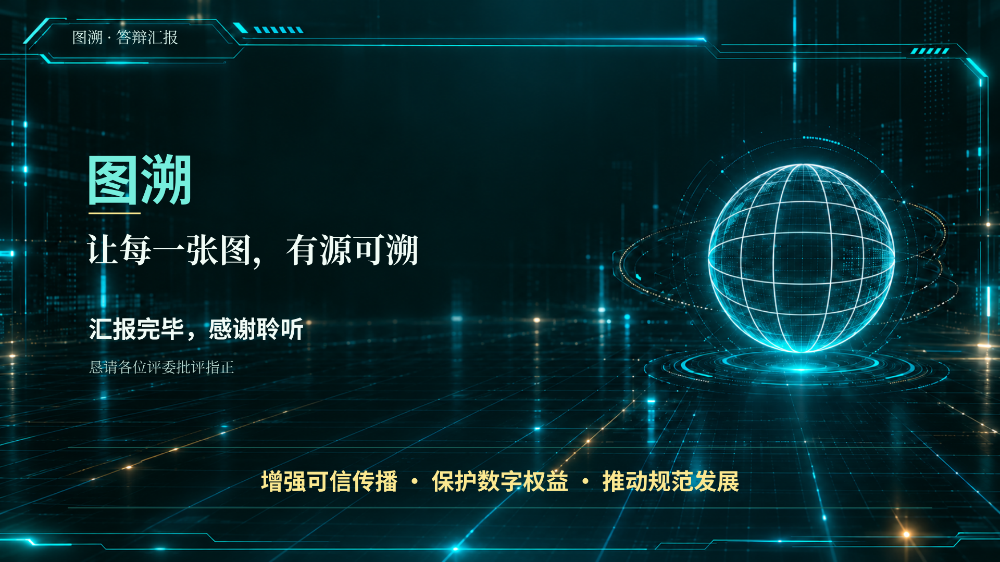

# 图溯 · 答辩结束页

[下载单页PPTX](tusu-closing.pptx) · [查看高清图片](tusu-closing.png)

沿用定稿PPT的深绿背景、青绿色边框、球面意象、白色与淡金文字。背景参考原末页清理重绘；PPTX文字可编辑，未替换或修改原16页文件。

文案：

图溯

让每一张图，有源可溯

增强可信传播 · 保护数字权益 · 推动规范发展

汇报完毕，感谢聆听

恳请各位评委批评指正

