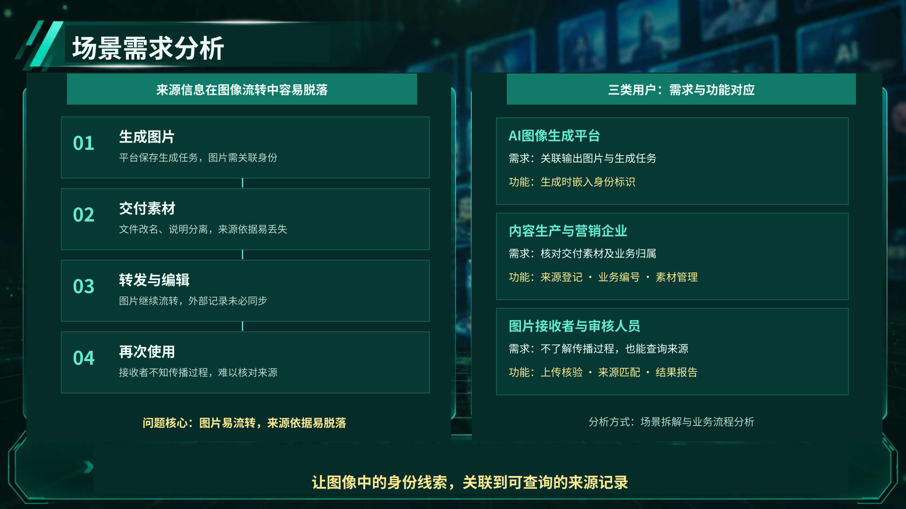
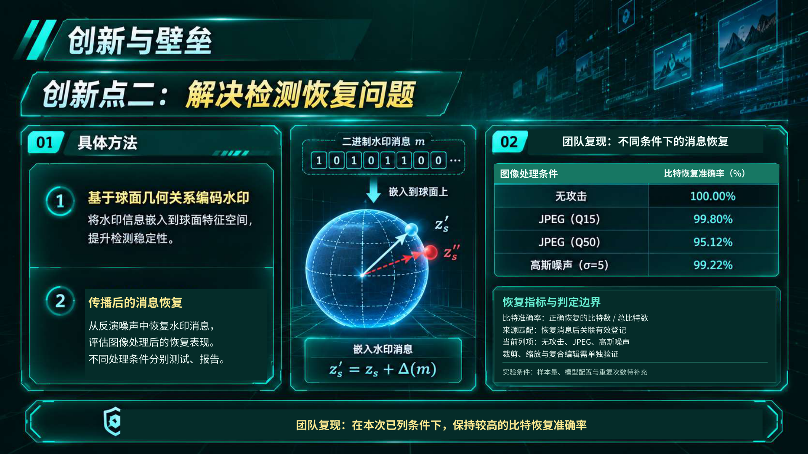
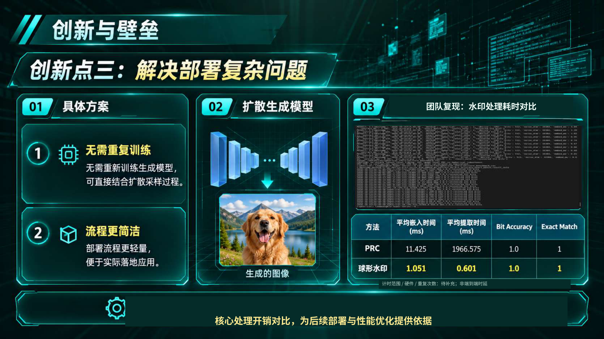

# 图溯 · 定稿局部修订

仅修改第4、8、9页；保留深绿色科技风及其他13页。未改动原实验数值。

- [下载PPTX](tusu-revised.pptx)
- [查看PDF](tusu-revised.pdf)
- [修订说明](change-notes.txt)

第4页将无原始记录支撑的统计图换为场景需求分析。第8页标明团队复现及比特恢复指标，限定结论范围。第9页标明团队复现，保留原时间表头及数值，提示计时条件待补充；未擅自推断为端到端时延。

实验样本量、模型配置、硬件、重复次数和计时范围仍需团队补充；JPEG Q15/Q50的结果与参数对应关系仍需核对。

原输入为整页图片PDF，PPTX原内容按背景图保留；新增修改文字和图形可编辑。PDF为准确视觉预览版；PPTX在不同设备上的字体显示可能略有差异。

## 第4页

## 第8页

## 第9页

