# 图溯 · 全功能页面截图

15 张独立页面 + 1 张功能总览，均为 3840 × 2160，16:9，可直接用于 PPT。

[下载完整截图包](tusu-function-screenshots.zip)

说明：截图来自实际网页操作和演示工作空间。球形水印页展示当前接入界面与未配置状态；嵌入与核验使用内置演示水印。服务方案页展示规划，不代表已收费或已有商业客户。

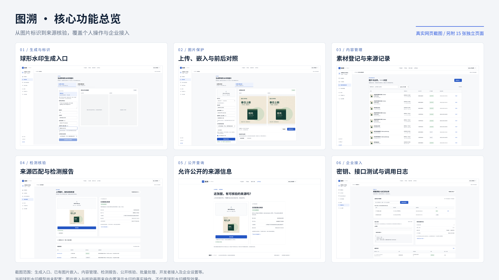

## 01 · 产品首页与服务定位

服务对象、核心价值与主要入口

[查看原图](01-home.png)

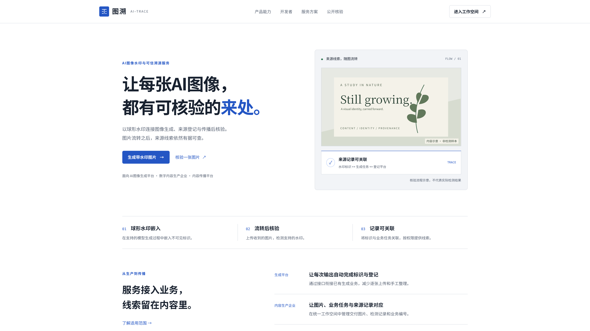

## 02 · 企业工作空间概览

真实登记数量、操作日志、接入引导与模型环境状态

[查看原图](02-overview.png)

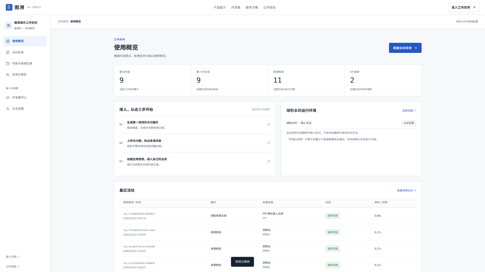

## 03 · 球形水印生成入口

画面描述、球形水印默认启用、业务登记；当前模型未配置

[查看原图](03-spherical.png)

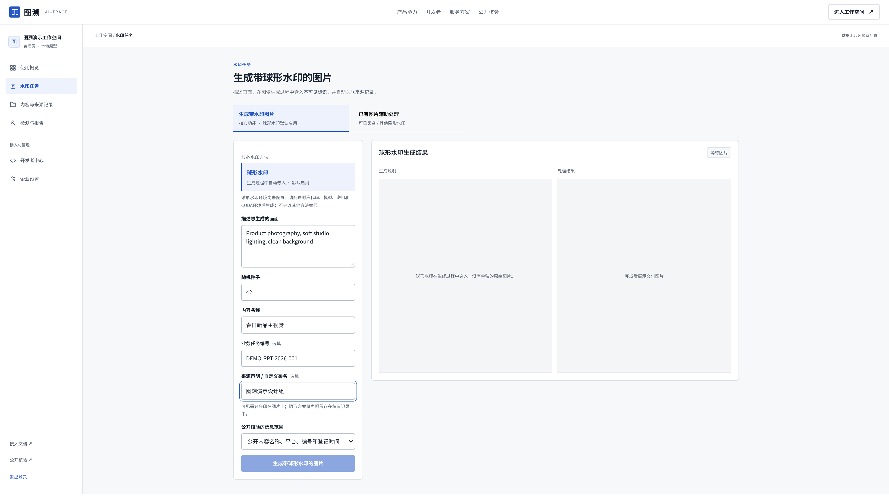

## 04 · 已有图片辅助嵌入

真实演示水印、前后对照、交付下载；不是球形水印实测

[查看原图](04-embed.png)

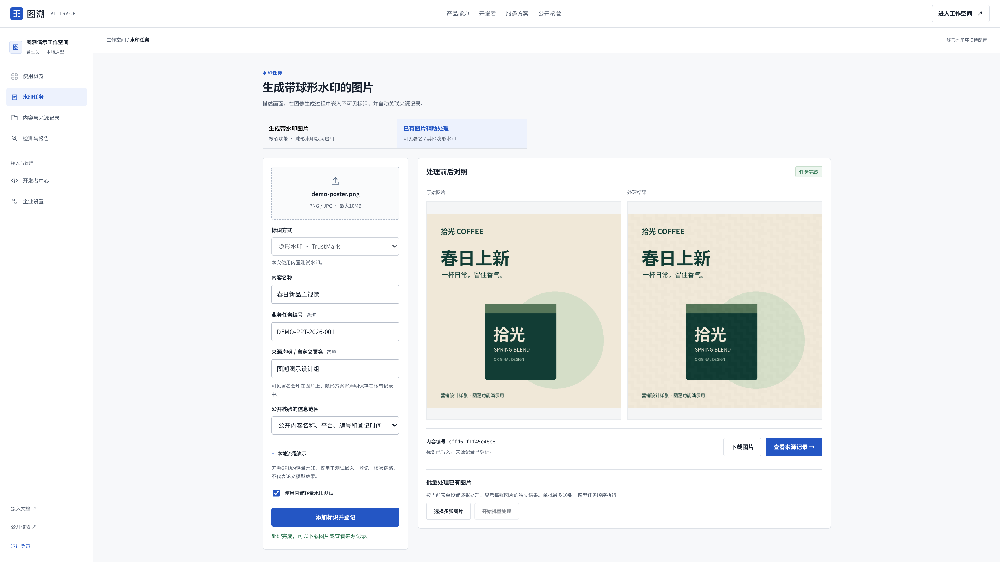

## 05 · 内容与来源管理

搜索筛选、业务编号、标识方式和公开状态

[查看原图](05-content.png)

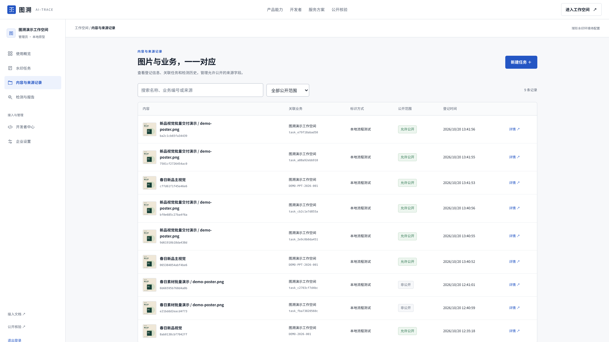

## 06 · 来源记录详情

来源声明、业务关联、公开范围、图片与核验历史

[查看原图](06-detail.png)

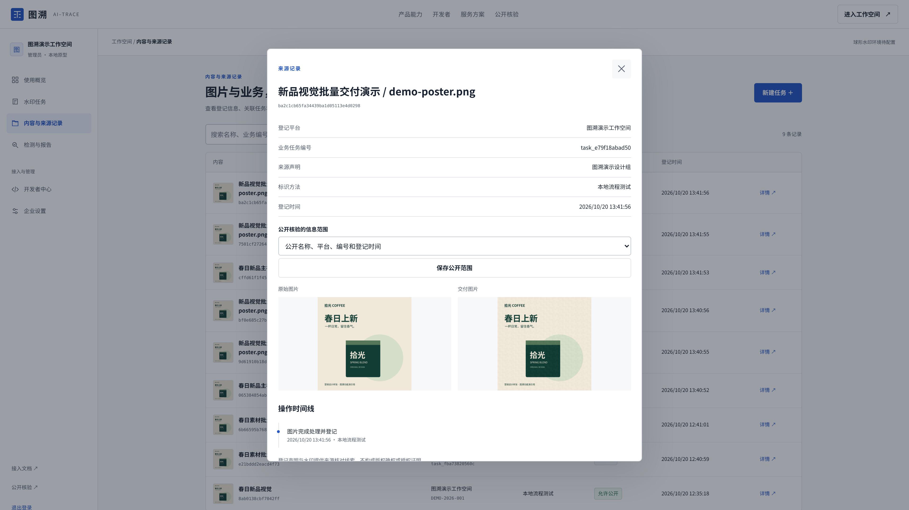

## 07 · 企业检测与报告

真实来源匹配、内部任务关联、核验报告与历史

[查看原图](07-detection.png)

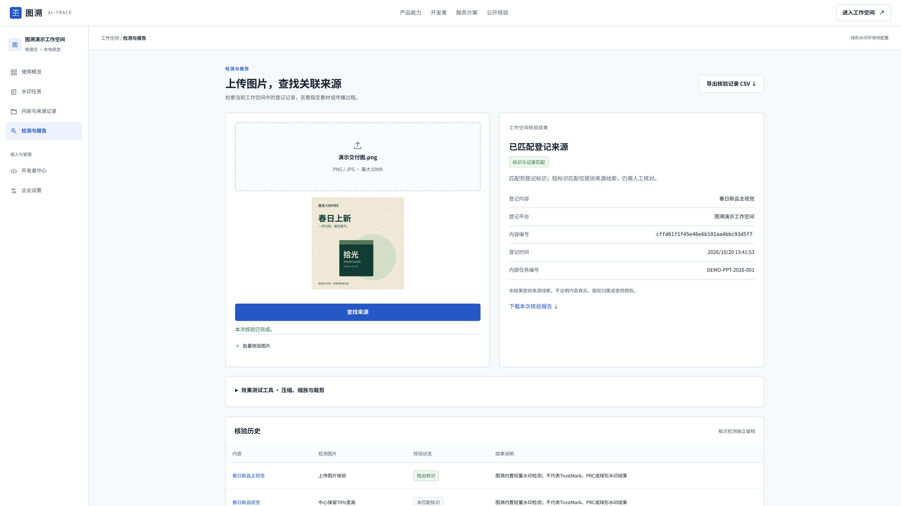

## 08 · 公开来源核验

无需登录，只展示登记方允许公开的来源字段

[查看原图](08-public.png)

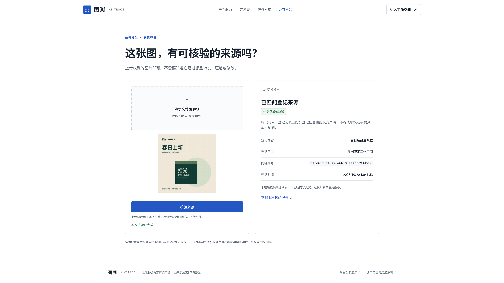

## 09 · 批量水印处理

两张图片顺序处理、各自保留结果并可下载

[查看原图](09-batch-embed.png)

## 10 · 批量图片核验

分别展示匹配与未匹配结果，支持下载本批报告

[查看原图](10-batch-verify.png)

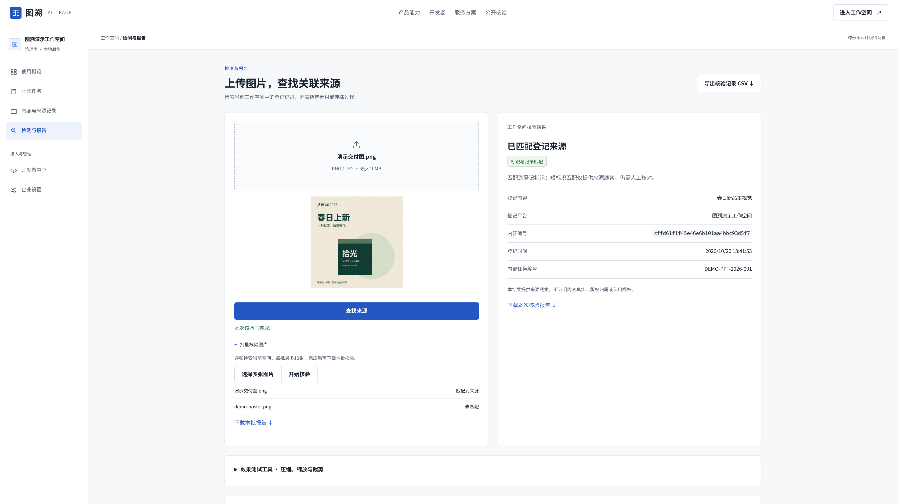

## 11 · 开发者接入与调用日志

应用密钥管理、真实HTTP请求测试、调用记录与用量

[查看原图](11-developer.png)

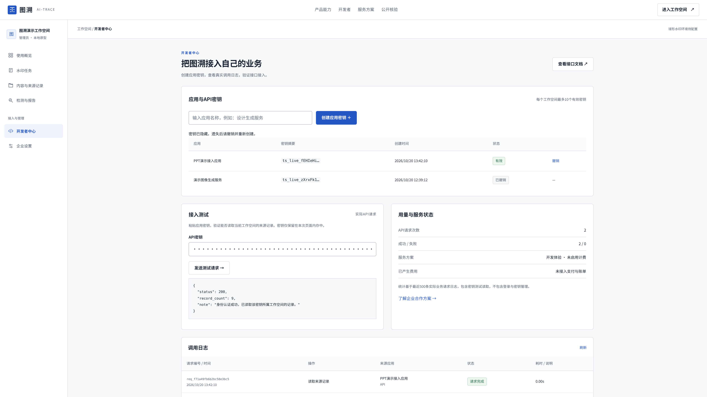

## 12 · API接口文档

球形水印生成请求、异步任务查询与来源核验接口

[查看原图](12-api-docs.png)

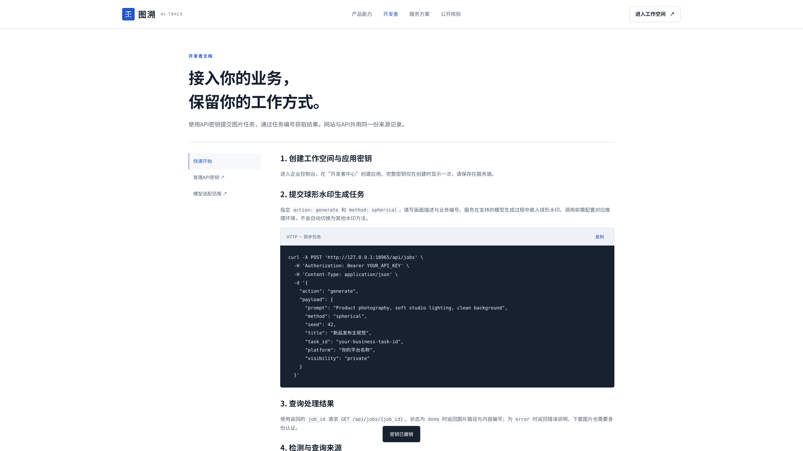

## 13 · 企业服务方案

API按量、年度订阅和私有化部署；尚未开放在线支付

[查看原图](13-plans.png)

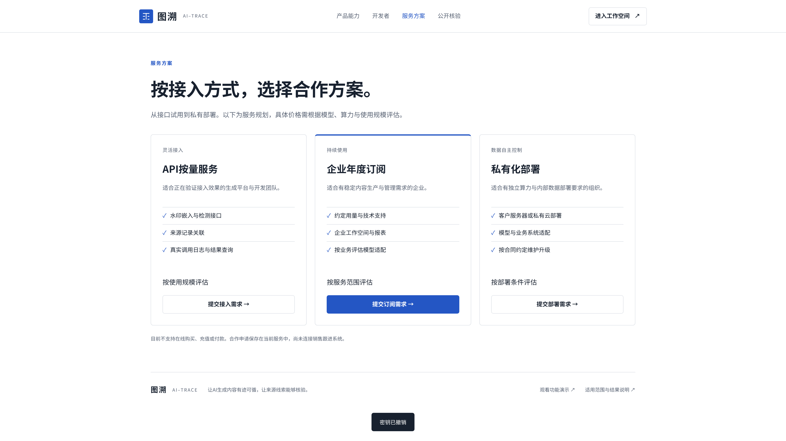

## 14 · 企业设置与访问规则

工作空间名称、管理员、数据范围和信息公开规则

[查看原图](14-settings.png)

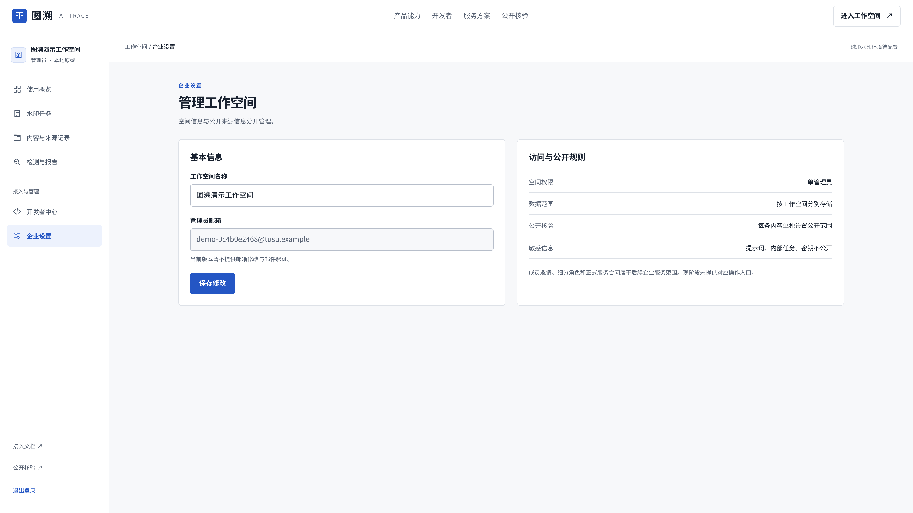

## 15 · 账户与工作空间创建

创建独立工作空间、账户登录与访问入口

[查看原图](15-account.png)

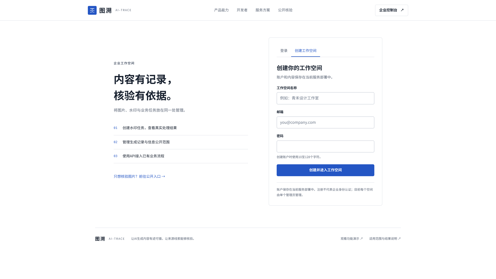
