# 图溯：球形水印2026 学术图文版

本页包含最新16页PPT预览，直接向下滚动即可查看，不需要启动Codespaces。

[下载可编辑PPT](Tusu_Editable.pptx) · [打开PDF文件页](Tusu_Preview.pdf) · [下载PDF](https://raw.githubusercontent.com/Ssir-creator/AIC/main/ppt-academic/Tusu_Preview.pdf)

论文框架与实验图均注明来源；项目尚未完成的评测没有写成已有成果。

## 01 · 封面

## 02 · 具体场景

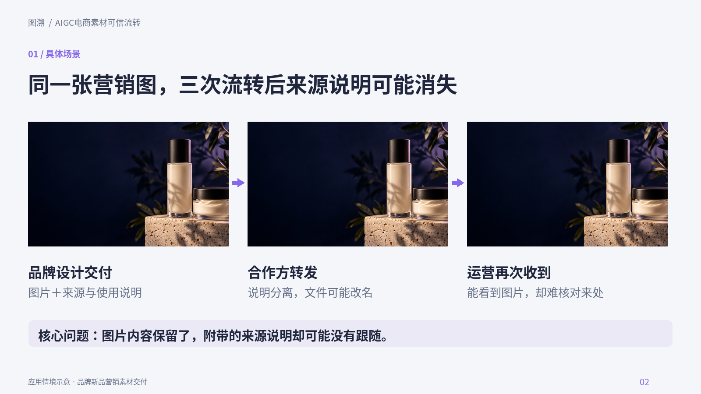

## 03 · 用户痛点

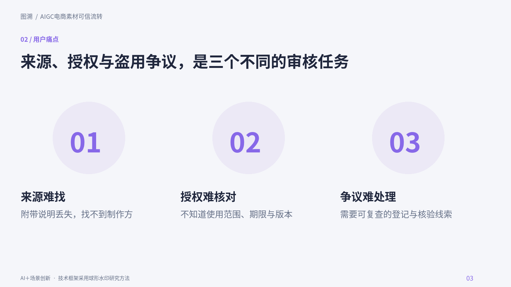

## 04 · 用户需求与调研

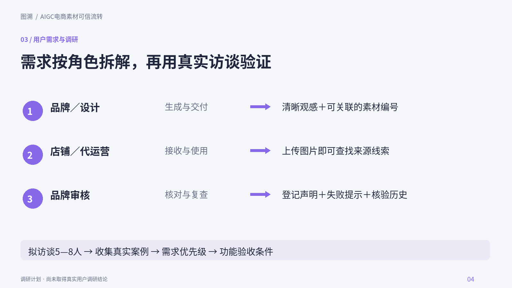

## 05 · 现有方案对比

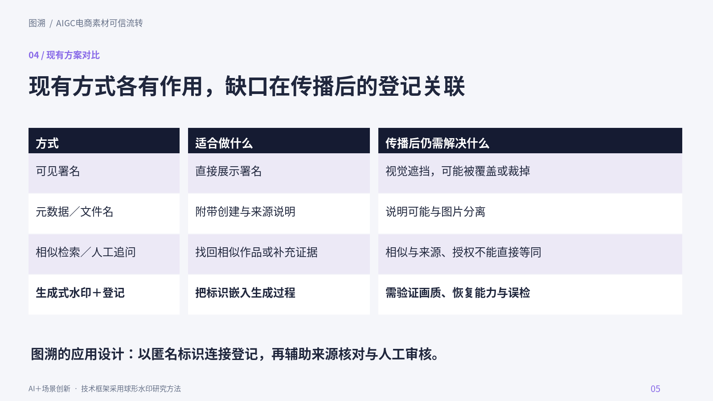

## 06 · 场景解决方案

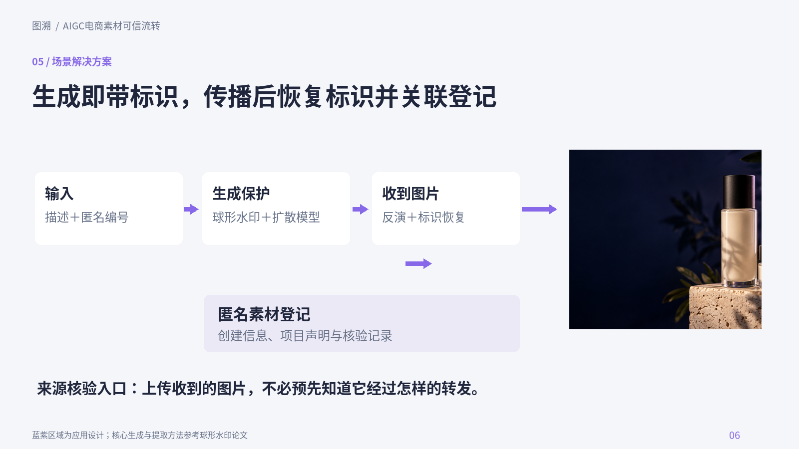

## 07 · 论文总体框架

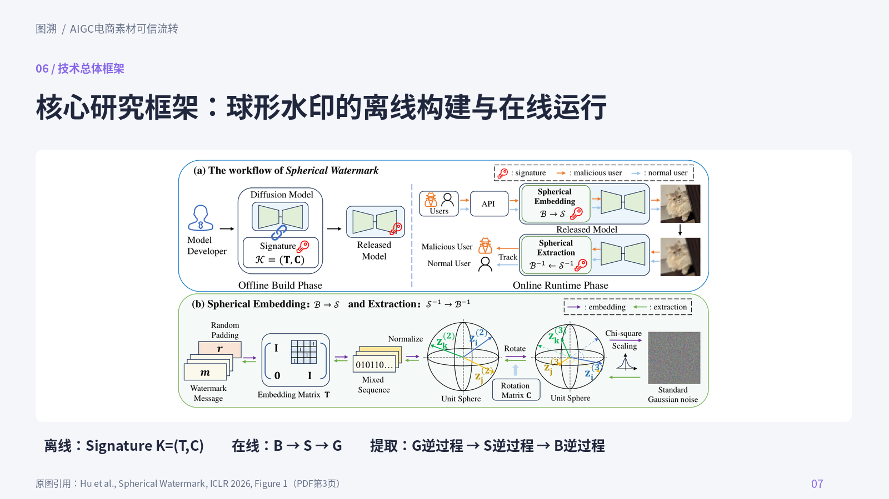

## 08 · 生成端技术方案

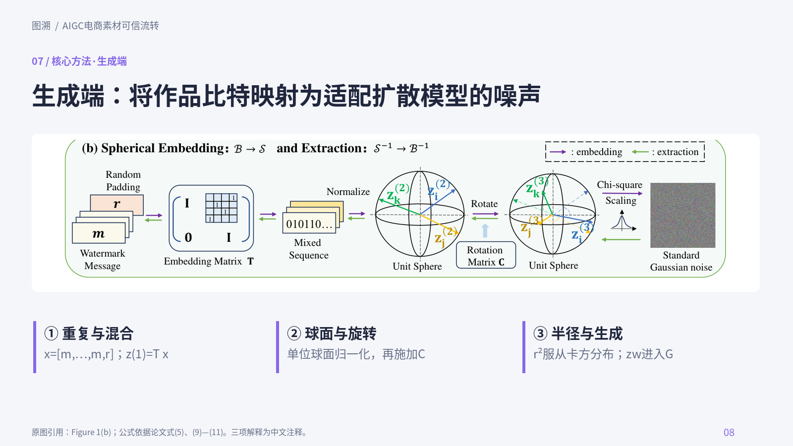

## 09 · 溯源端技术方案

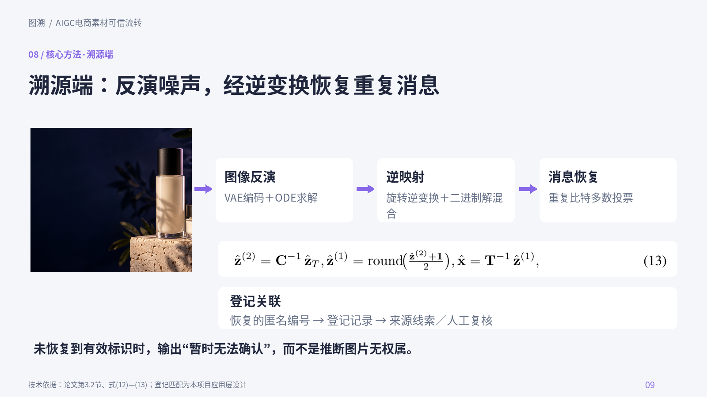

## 10 · 方法适配性与公式

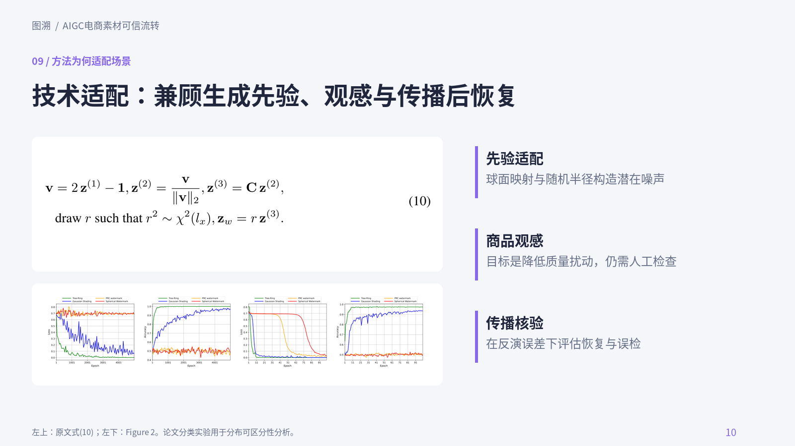

## 11 · 场景创新

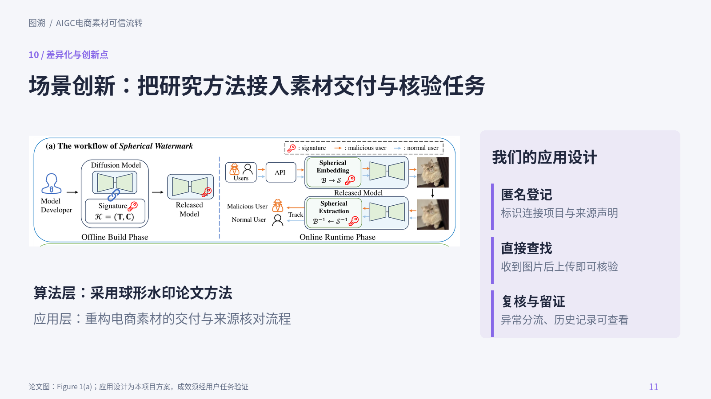

## 12 · 产品体验示意

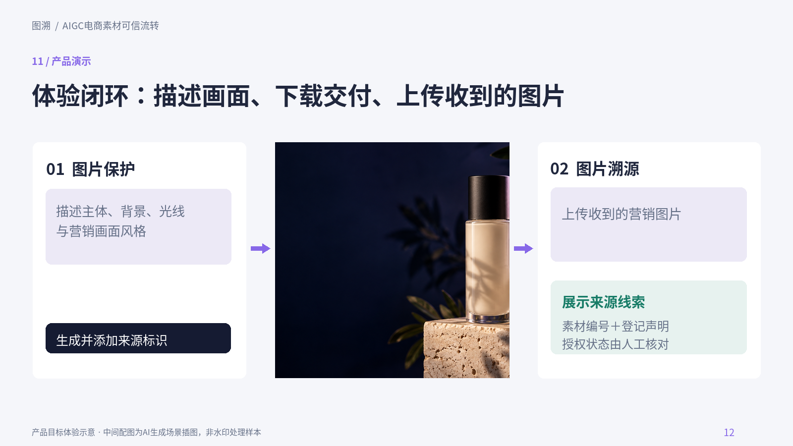

## 13 · 测试方案

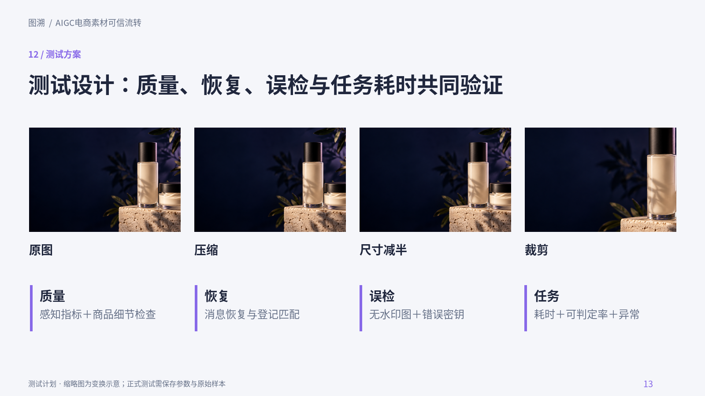

## 14 · 论文实验与项目验证状态

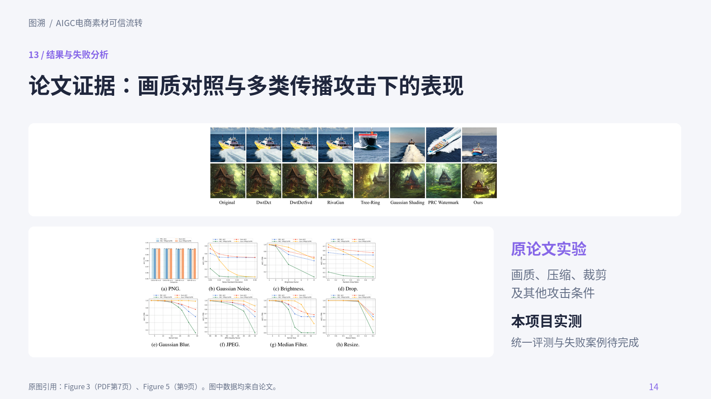

## 15 · 应用价值与落地

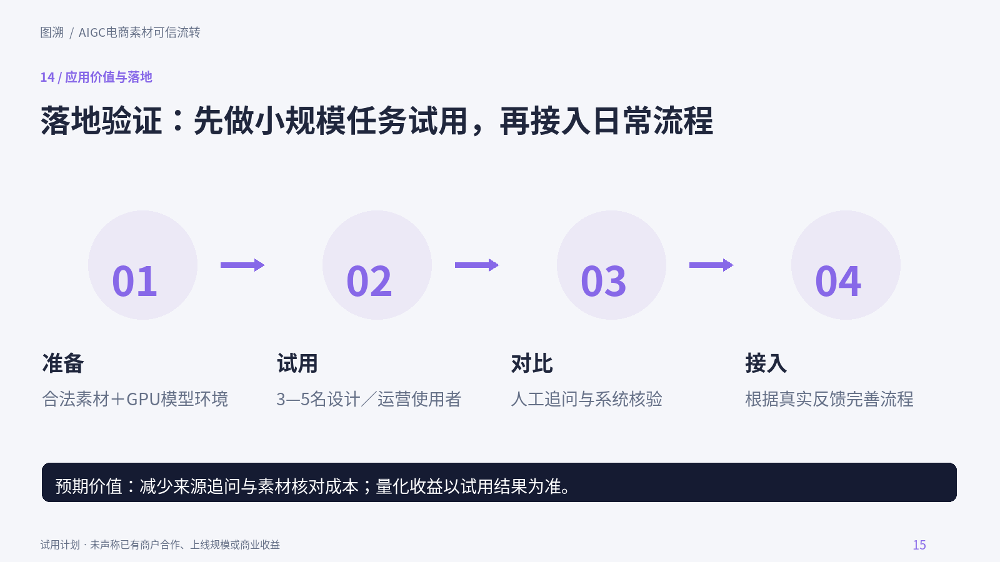

## 16 · 总结

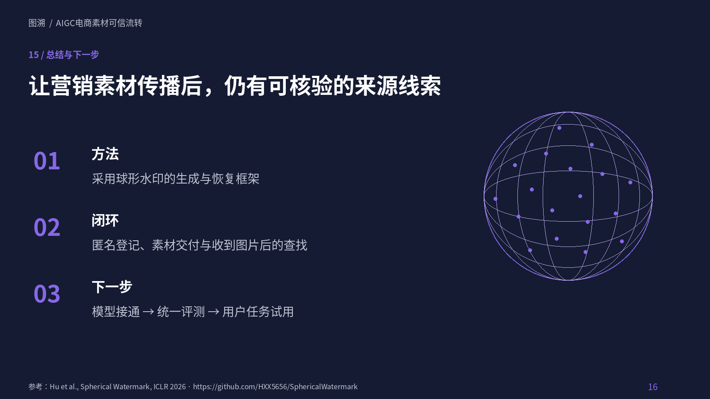