# 图溯 · 白底学术答辩版 · 三份参考稿重排版

**34页，包含目录、4个章节过渡与评分附录。** 按水下机器人、铁轨守卫者、第三份答辩稿的图文组织重新设计。

[返回两版总览](../README.md) · [下载PPT](Tusu.pptx) · [浏览PDF](Tusu.pdf) · [测试证据](../evidence/README.md)

## 01 · 项目概述

图溯：来源认证与溯源方案

## 02 · 汇报提纲

从实际问题，到可验证的应用方案

## 03 · 第1章

研究背景与需求

## 04 · 大背景

图像不仅传递信息，也承载创意、品牌与资产价值

## 05 · 核心矛盾

画面可以完整保留，来源说明却可能在传播中脱落

## 06 · 验证场景

用一张电商营销图，贯穿生成、交付与再次核验

## 07 · 需求分析 · 问题剖析

真正的断点，发生在“制作—交付—再次使用”的责任交接处

## 08 · 需求分析 · 调研方法

访谈问清真实经历，任务观察检验实际操作成本

## 09 · 需求分析

把用户的疑问，转化为可实现、可验收的系统要求

## 10 · 现有方案

单一保护方式，难以覆盖传播后的完整核验任务

## 11 · 第2章

方案与技术设计

## 12 · 创新与壁垒

把研究方法转化为可使用、可复查的可信传播流程

## 13 · 业务落地 · 操作闭环

一次交付建立身份，一次上传启动来源核验

## 14 · 总体方案

生成侧建立身份，接收侧恢复身份，登记层连接两端

## 15 · 技术选型

球形水印，适配“生成时标记、传播后核验”的需求

## 16 · 技术路线 · 生成端

作品身份 → 球面映射 → 扩散图像生成

## 17 · 技术路线 · 核验端

传播图像 → 反演与消息恢复 → 来源关联

## 18 · 产品原型 · 图片保护

登记、署名与交付效果，在一个页面完成

## 19 · 产品原型 · 图片溯源

上传收到的图片，直接查看可关联的来源线索

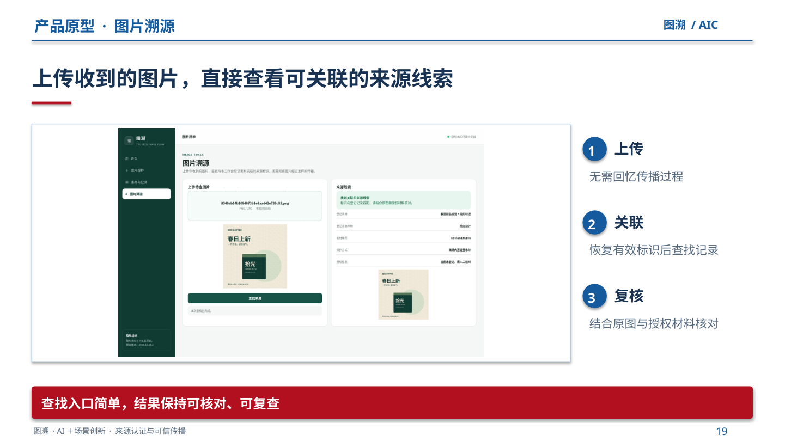

## 20 · 产品原型 · 素材与记录

把素材登记与核验历史放在同一条工作路径里

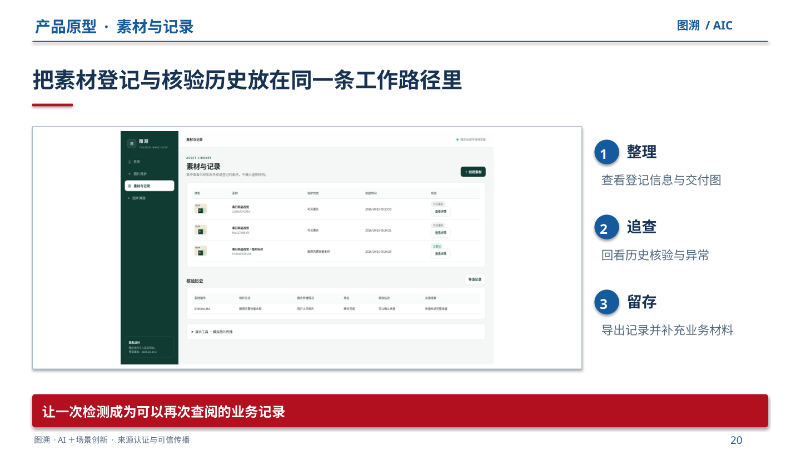

## 21 · 可行性 · 部署与资源

网页、任务服务与模型环境分离，按实际负载逐步接入

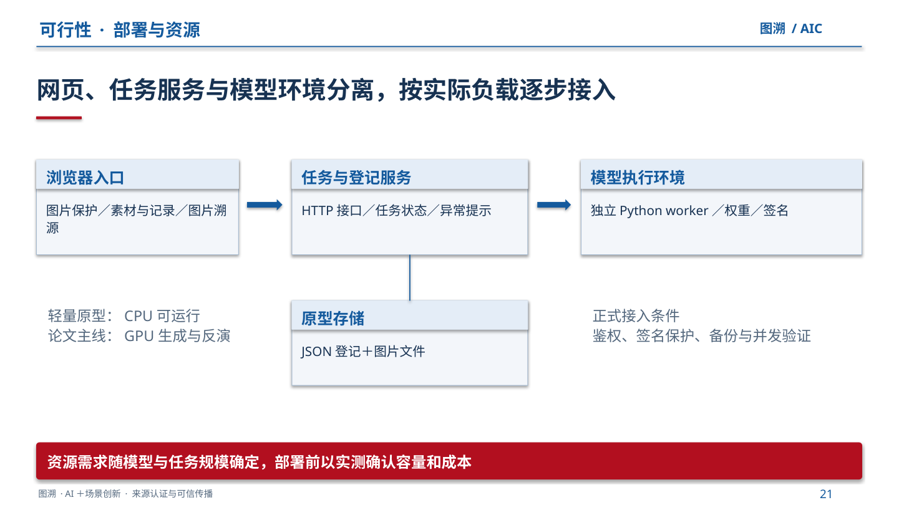

## 22 · 项目实施 · 里程碑与协作

用阶段验收和明确交付物，连接算法、产品与验证工作

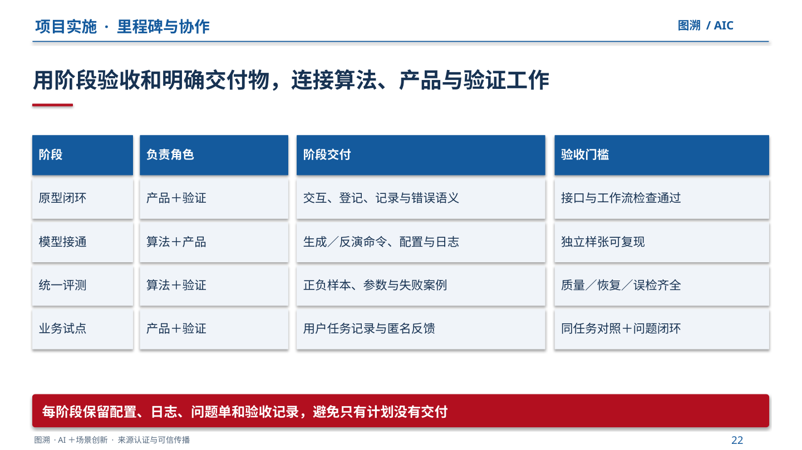

## 23 · 第3章

测试验证与应用

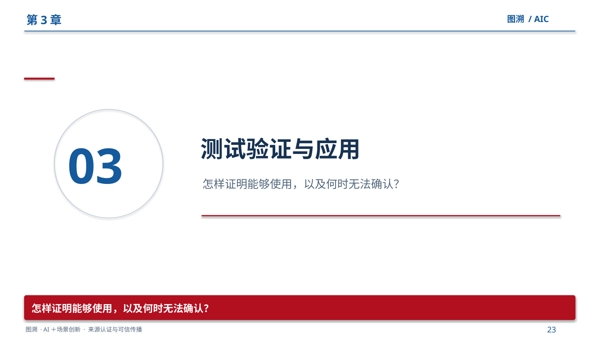

## 24 · 测试方案

用质量、恢复、误检与任务效率共同评价方案

## 25 · 测试与验证 · 受控试验

让结果同时呈现“可以恢复”与“暂时失效”的条件

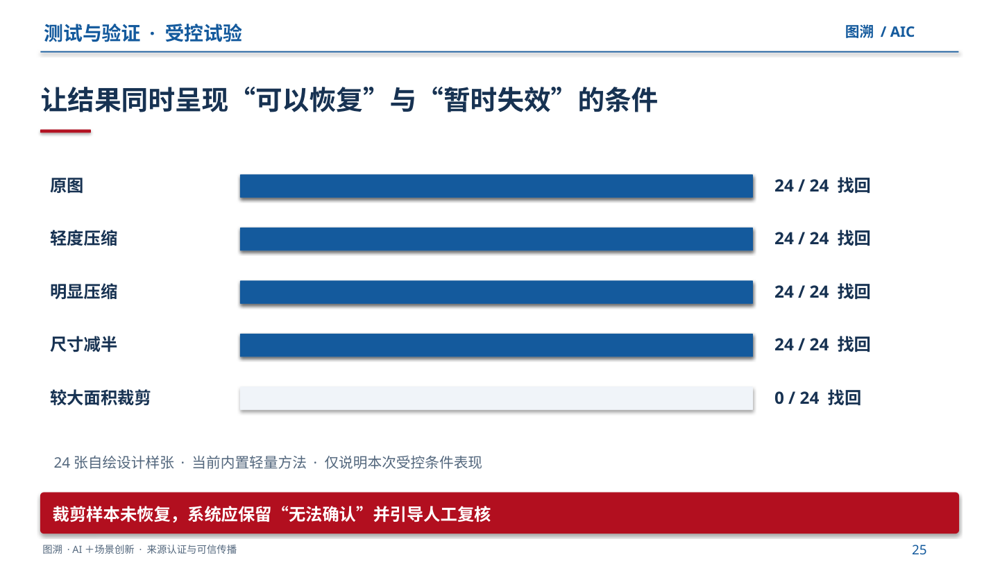

## 26 · 测试与验证 · 可靠性

不误导用户的失败提示，与成功检出同样重要

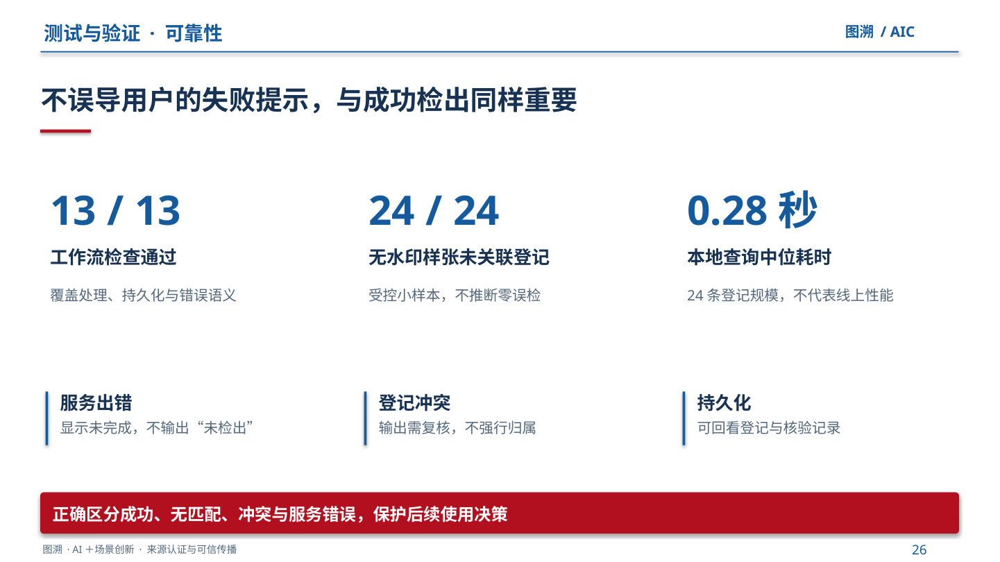

## 27 · 应用验证 · 场景案例

同一批样张，在“压缩、裁剪、未标记”下走向不同处理结果

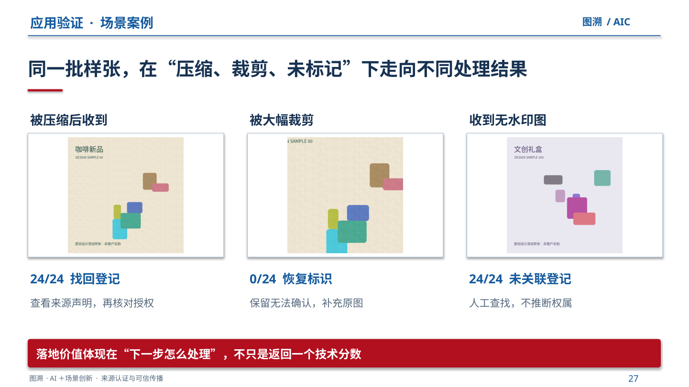

## 28 · 实际落地 · 试点设计

嵌入品牌现有交付流程，逐步取得真实用户效果

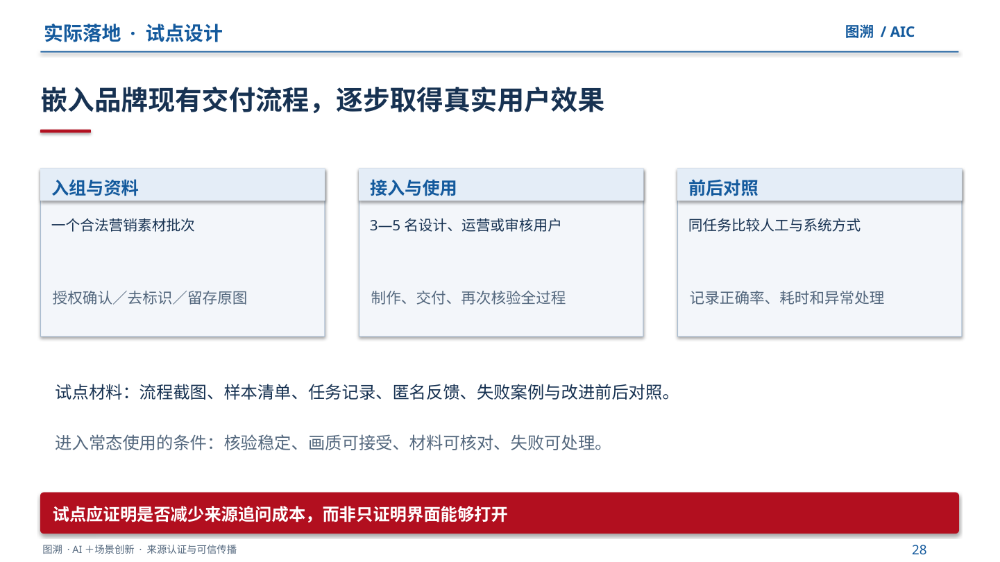

## 29 · 应用效果 · 成本收益

把价值落到核对工时、返工次数和接入成本

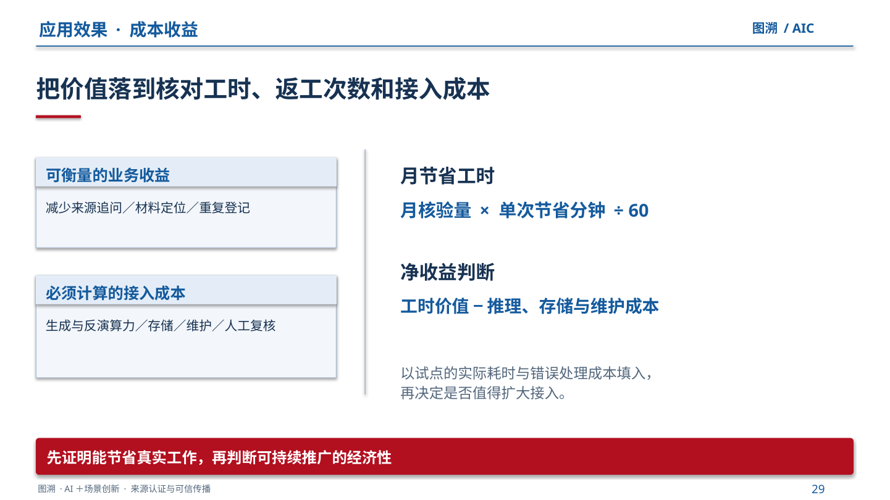

## 30 · 应用与落地

以电商验证任务，再向创意、文创和媒体延伸

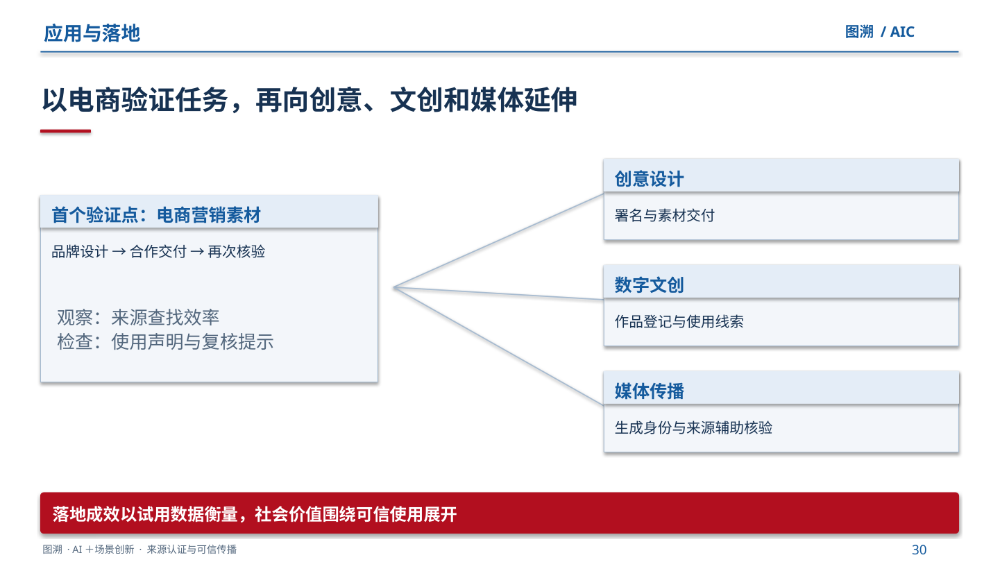

## 31 · 第4章

总结与展望

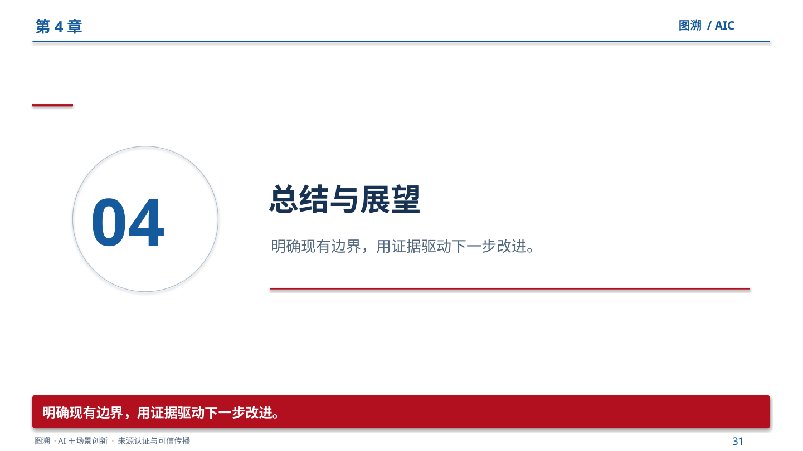

## 32 · 总结与展望 · 问题改进

把当前薄弱点，转化为有验证门槛的下一步工作

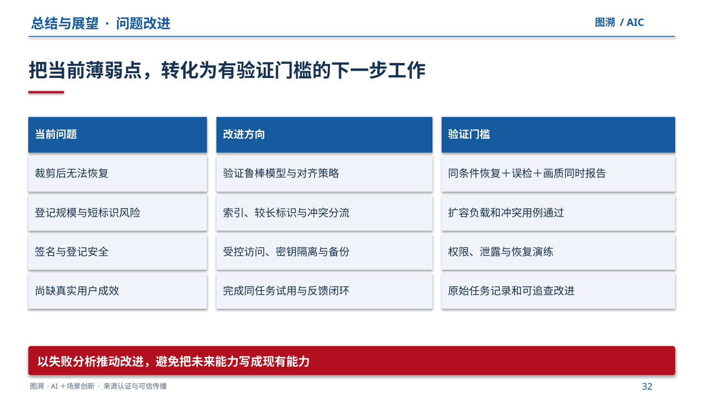

## 33 · 总结与展望

让图像的身份线索，跟得上内容的传播

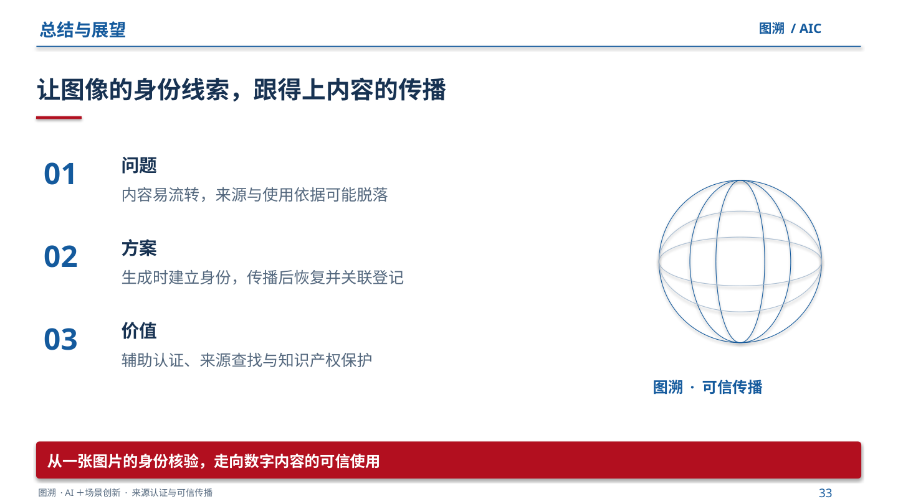

## 34 · 附录 · 评分对应

每一项评分，都对应具体论证、实现和证据

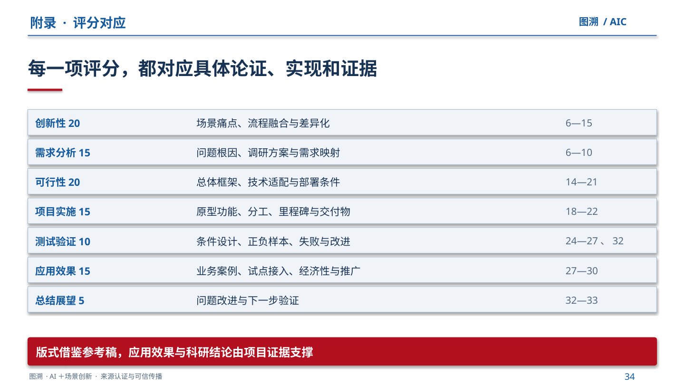
