# 图溯 · 深墨绿 · 重构版

**18页，同一套完整故事线。** 本次按背景、问题、需求、方案、验证、价值重新组织，论文图仅用于技术解释和实验分析。

[返回总览](../README.md) · [下载PPT](Tusu.pptx) · [查看PDF](Tusu.pdf)

## 01 · 项目概述

图溯

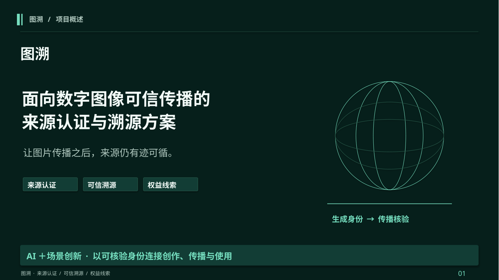

## 02 · 大背景

图像不仅传递信息，也承载创意、品牌与资产价值

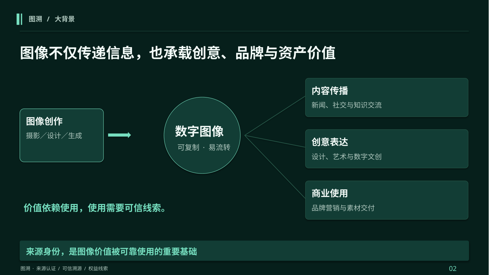

## 03 · 核心矛盾

画面可以完整保留，来源说明却可能在传播中脱落

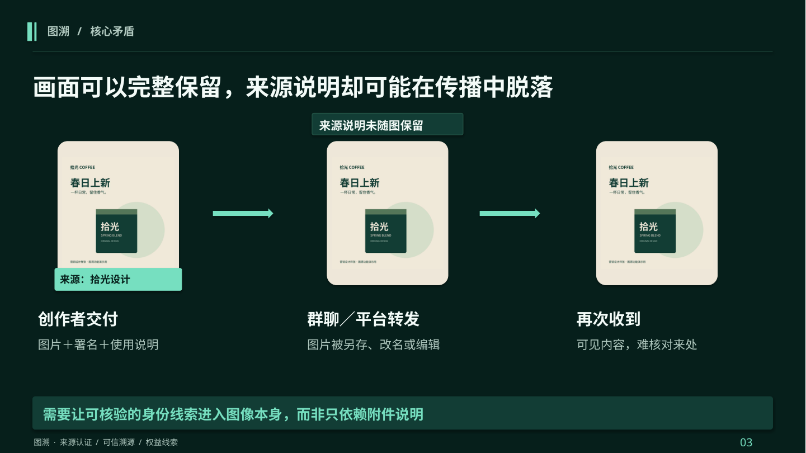

## 04 · 技术趋势

AIGC让图像更易生产，也让“凭外观看来源”更困难

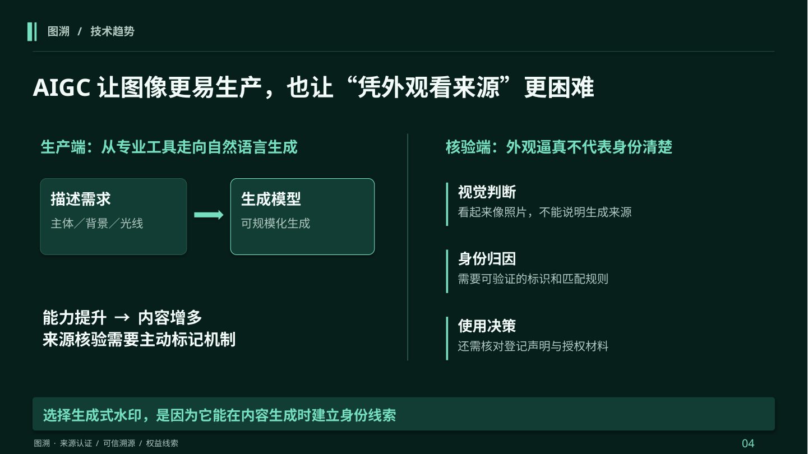

## 05 · 需求定义

认证、溯源与权益保护，需要衔接，但不能相互替代

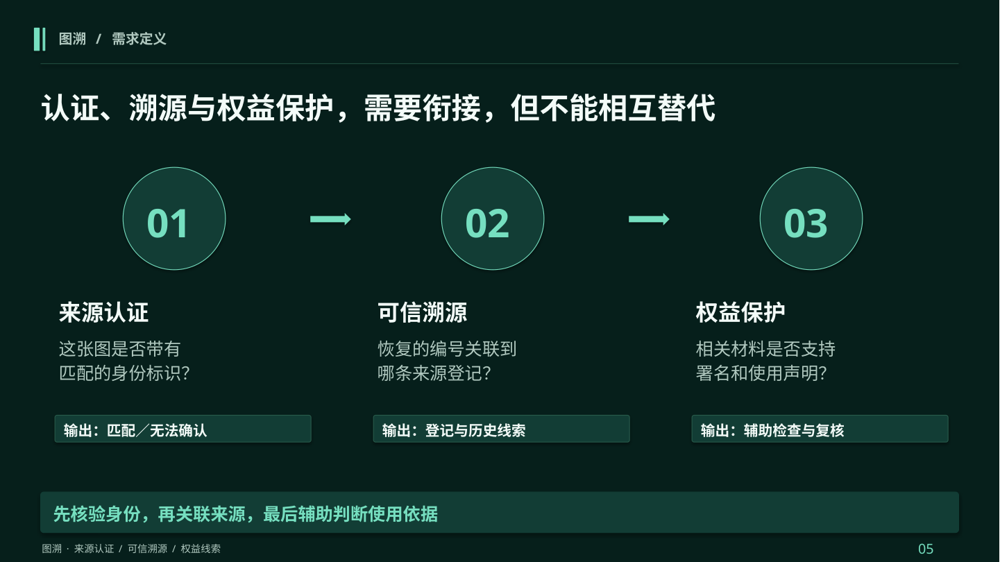

## 06 · 现有方案

单一保护方式，难以覆盖传播后的完整核验任务

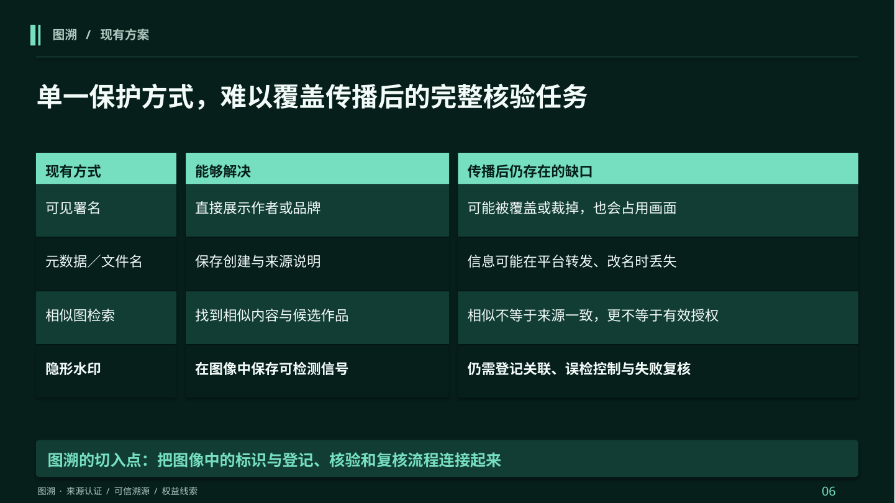

## 07 · 验证场景

用一张电商营销图，贯穿生成、交付与再次核验

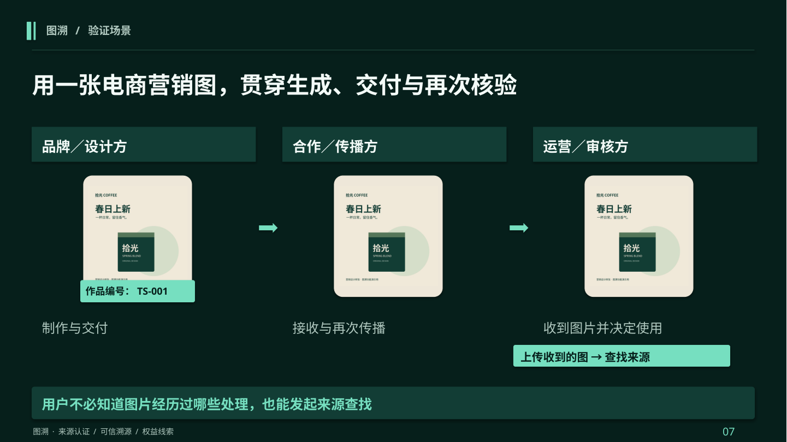

## 08 · 需求分析

把用户的疑问，转化为可实现、可验收的系统要求

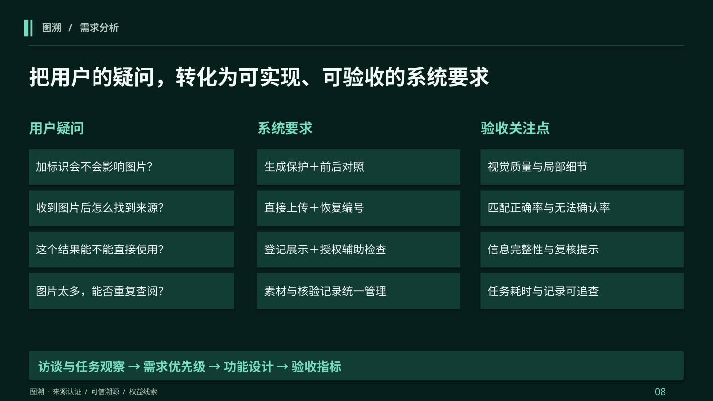

## 09 · 总体方案

生成侧建立身份，接收侧恢复身份，登记层连接两端

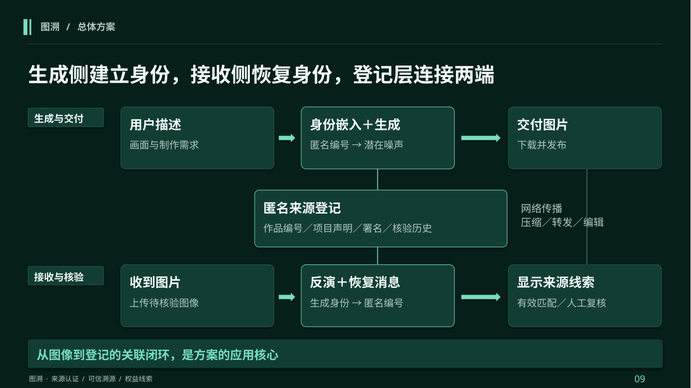

## 10 · 技术选型

球形水印，适配“生成时标记、传播后核验”的需求

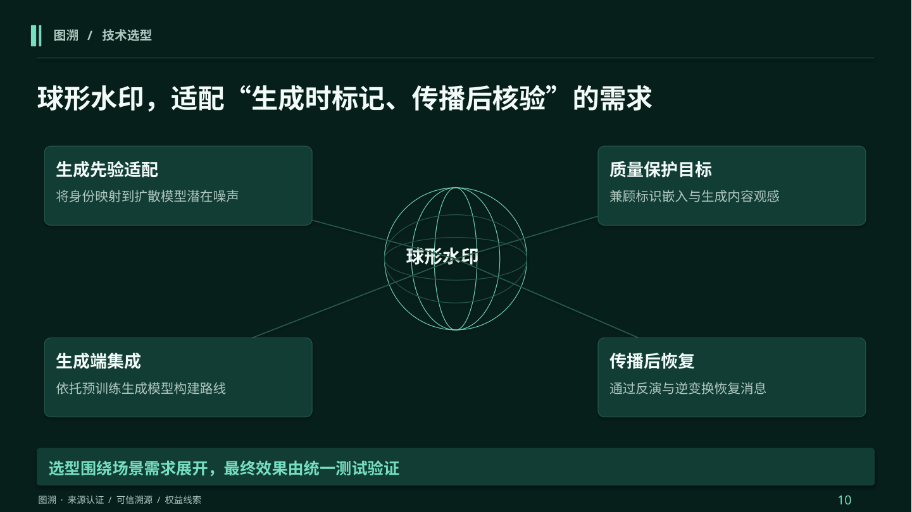

## 11 · 生成端技术

把作品身份映射为噪声，再参与扩散生成

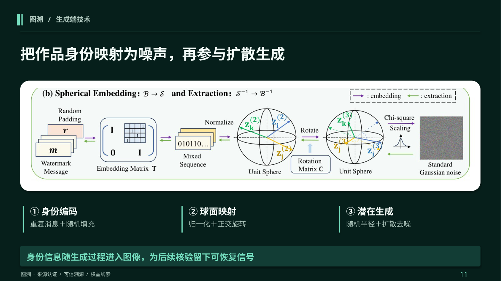

## 12 · 核验端技术

恢复标识之后，还要完成来源关联与有效性检查

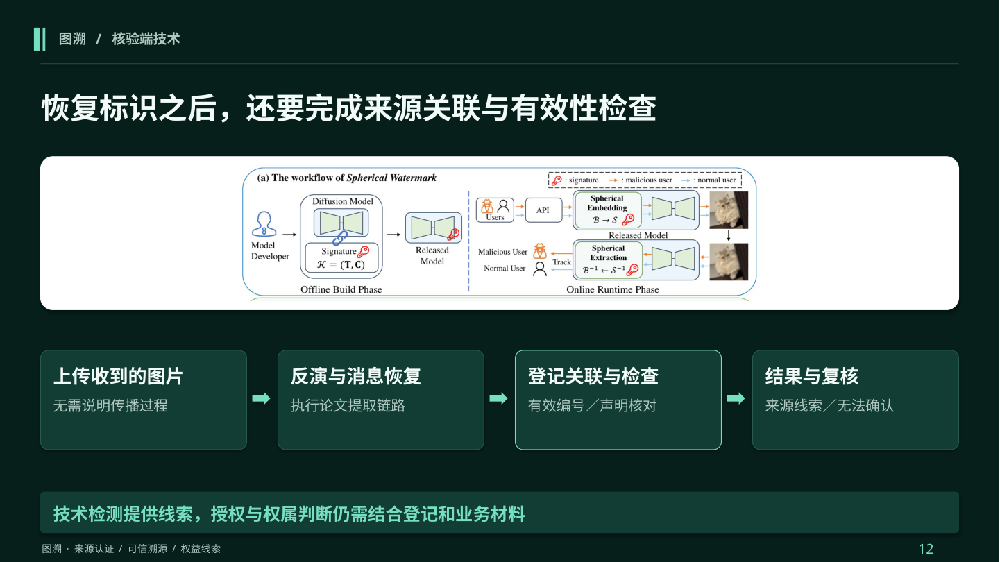

## 13 · 创新与壁垒

把研究方法转化为可使用、可复查的可信传播流程

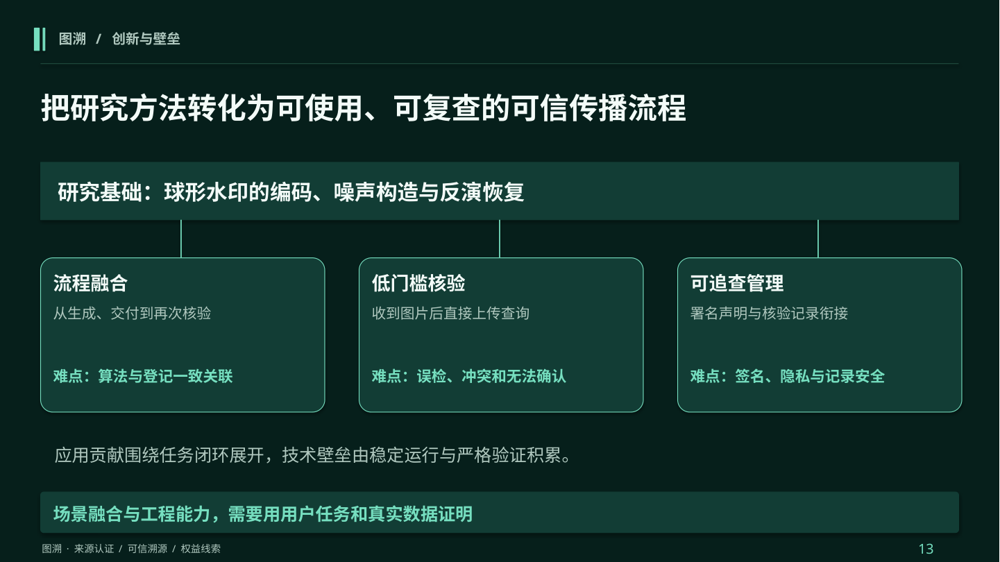

## 14 · 功能演示

保护与核验，落在用户看得见的两次操作上

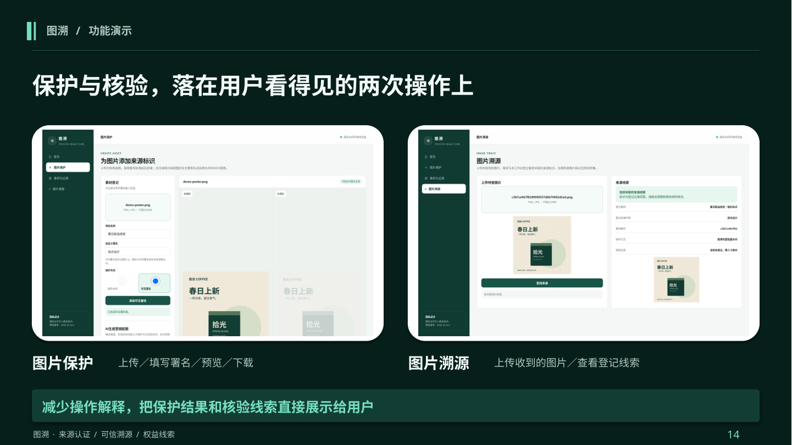

## 15 · 测试方案

用质量、恢复、误检与任务效率共同评价方案

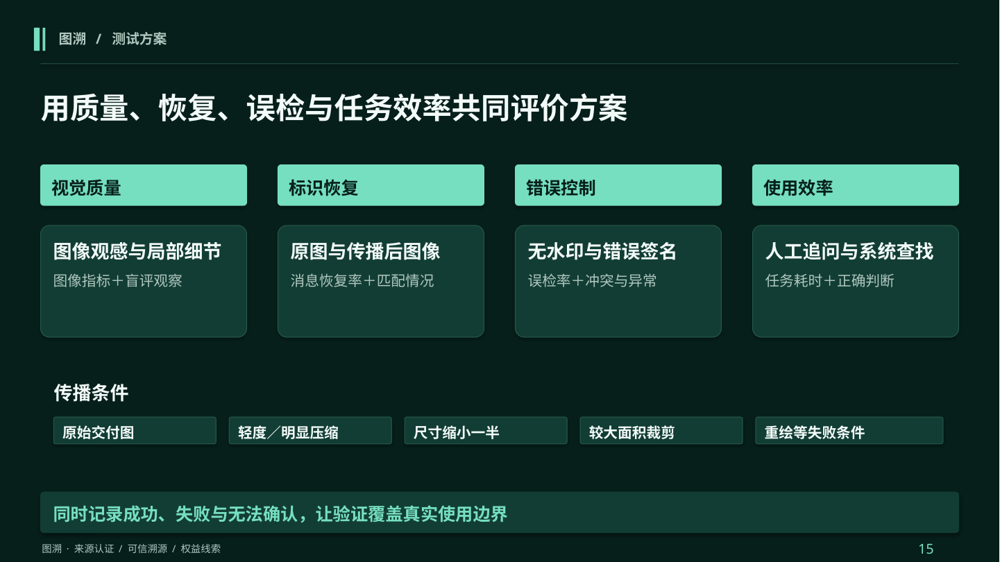

## 16 · 验证与分析

现有工作流可复查，核心方法按统一条件继续评价

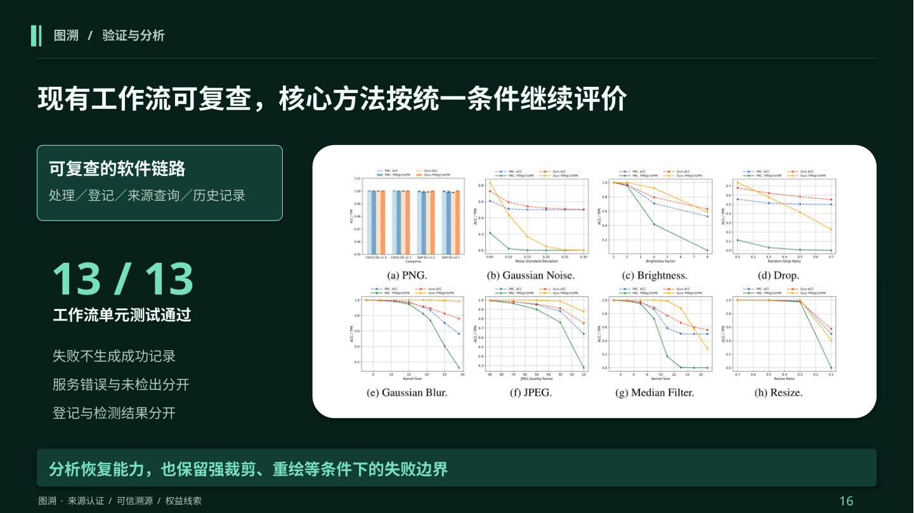

## 17 · 应用与落地

以电商验证任务，再向创意、文创和媒体延伸

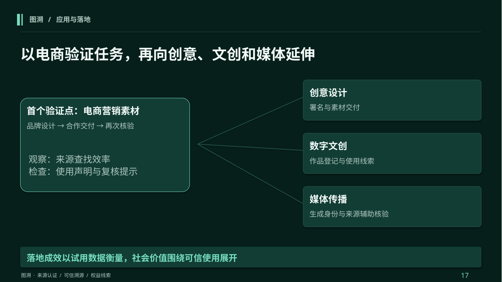

## 18 · 总结与展望

让图像的身份线索，跟得上内容的传播

