# 图溯 · 学术技术版

[返回两版总览](../README.md)

[下载可编辑 PPT](Tusu.pptx) · [浏览 PDF](Tusu.pdf)

19页，16:9。论文图保留为图片，标题、正文、结构线与流程模块可编辑。出处和验证范围置于演讲者备注。

## 01 · 图溯

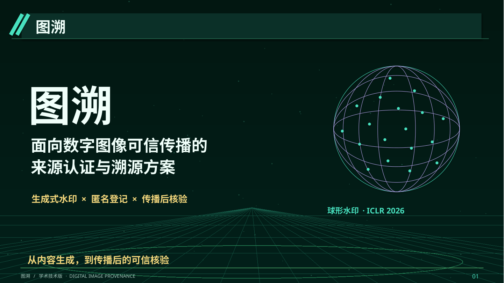

## 02 · 问题定义

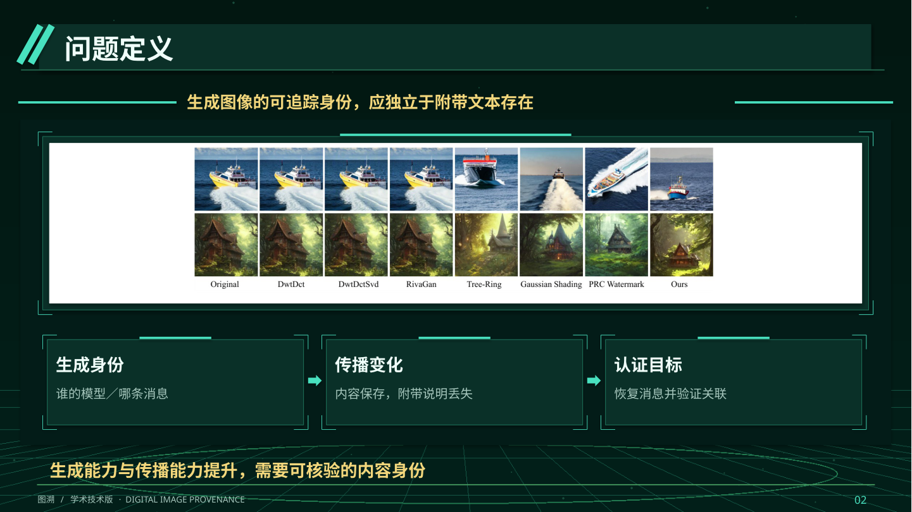

## 03 · 研究定位

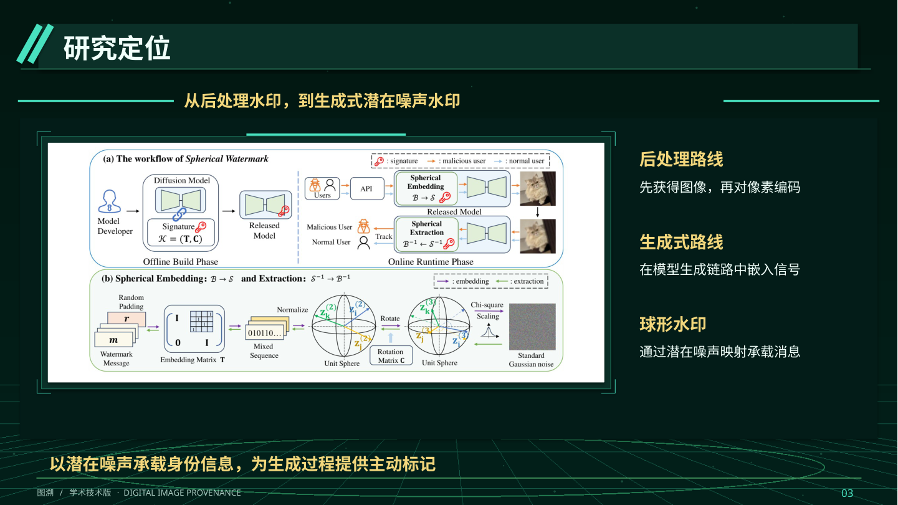

## 04 · 研究目标

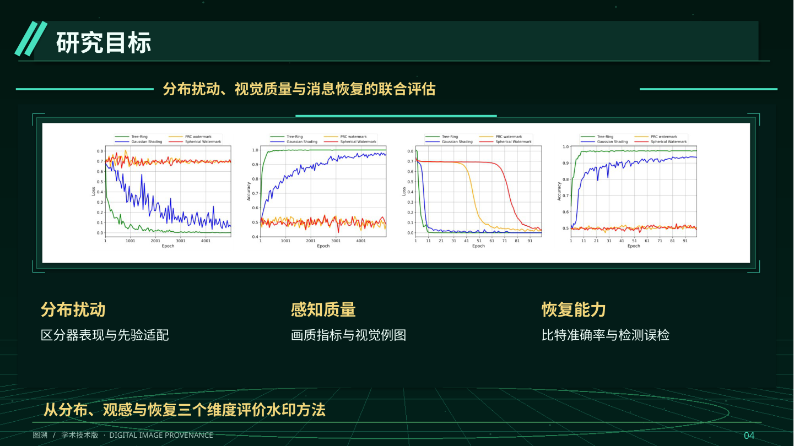

## 05 · 关键痛点

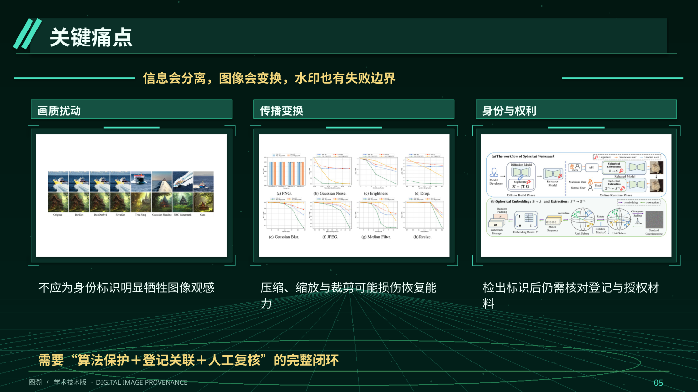

## 06 · 总体技术路线

## 07 · 可逆编码

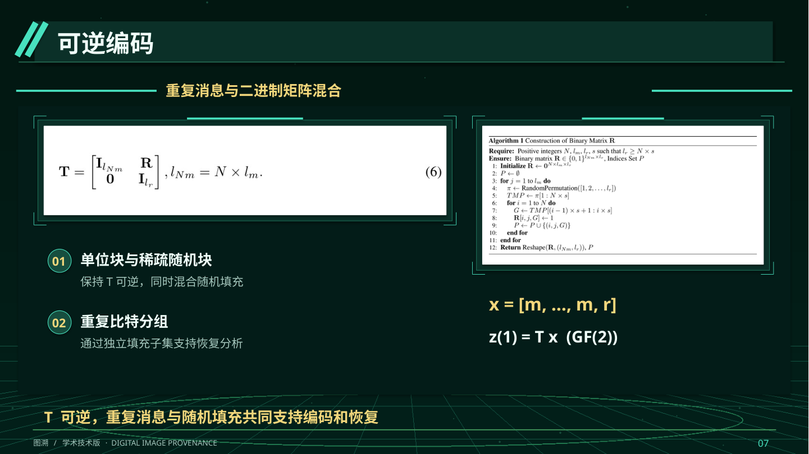

## 08 · 核心方法二

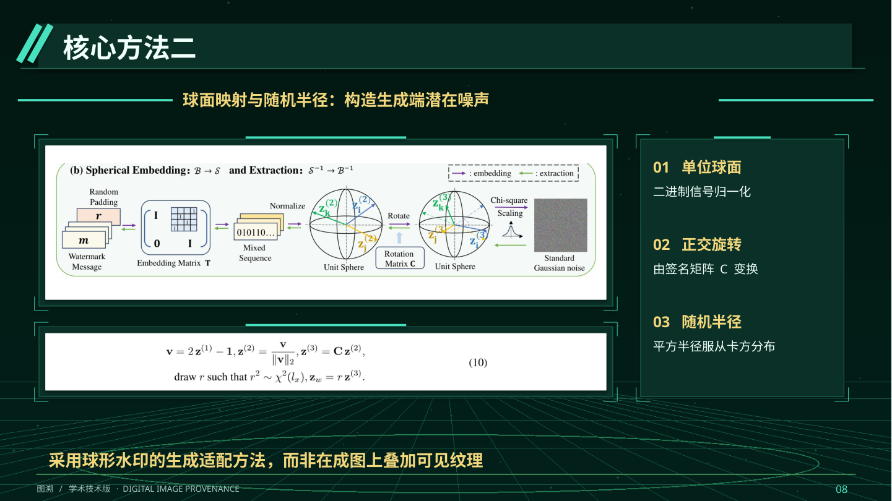

## 09 · 提取机制

## 10 · 签名构建

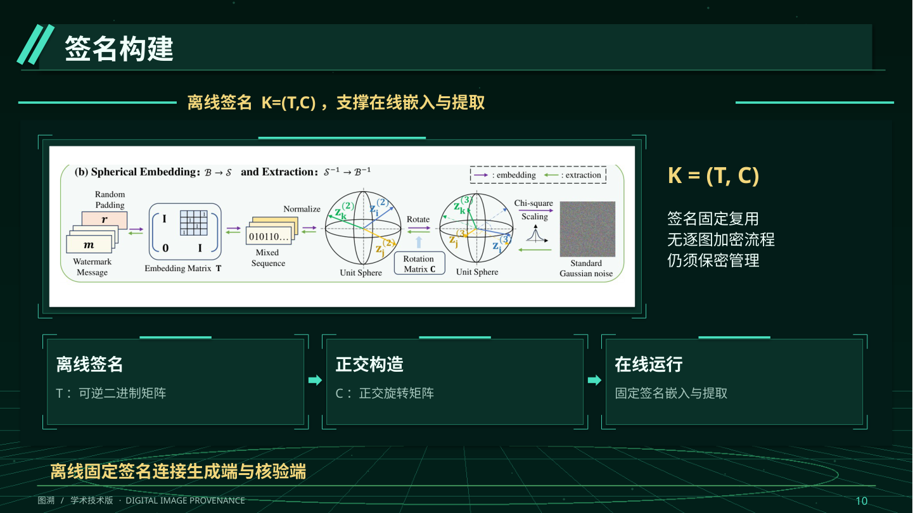

## 11 · 复现状态

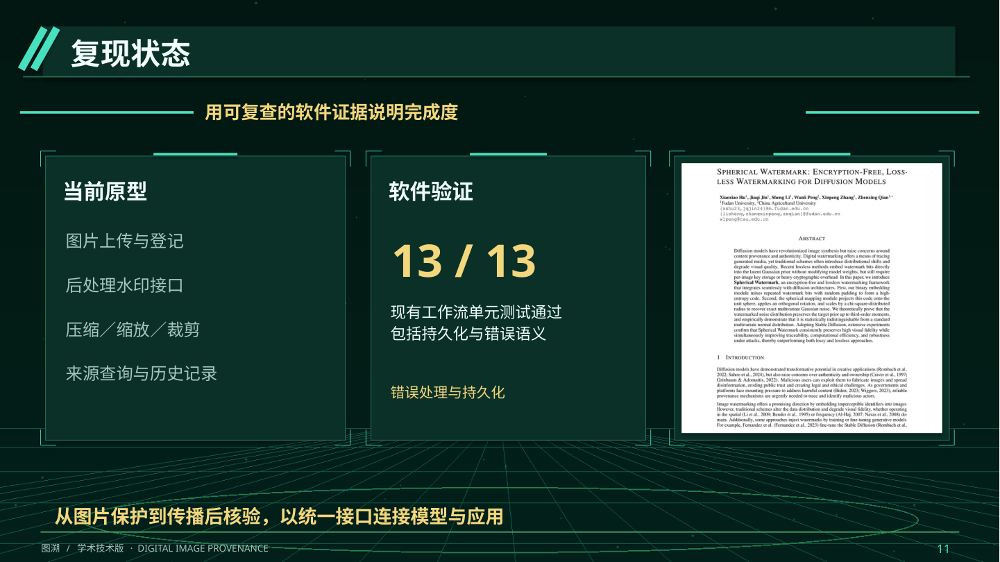

## 12 · 质量验证

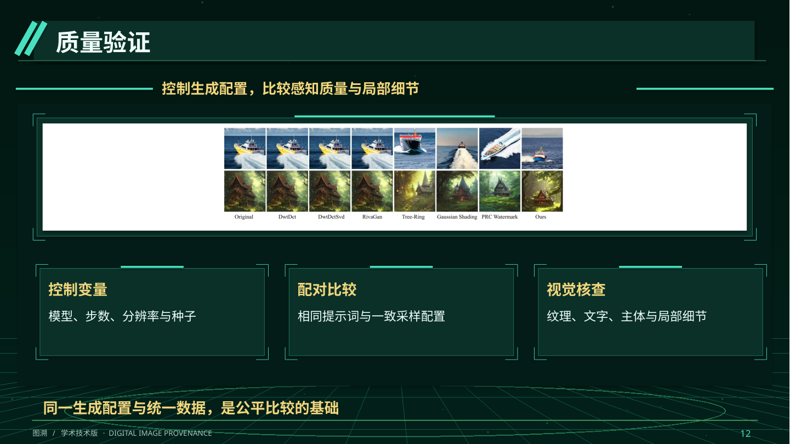

## 13 · 实施条件

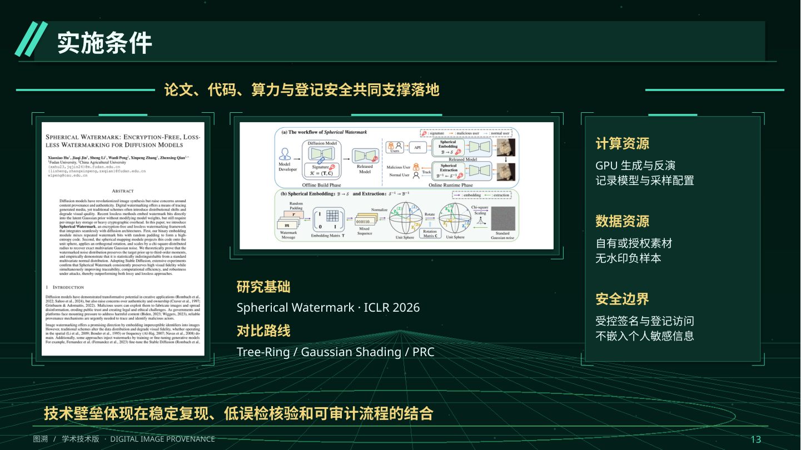

## 14 · 参数消融

## 15 · 测试与验证

## 16 · 方案比较

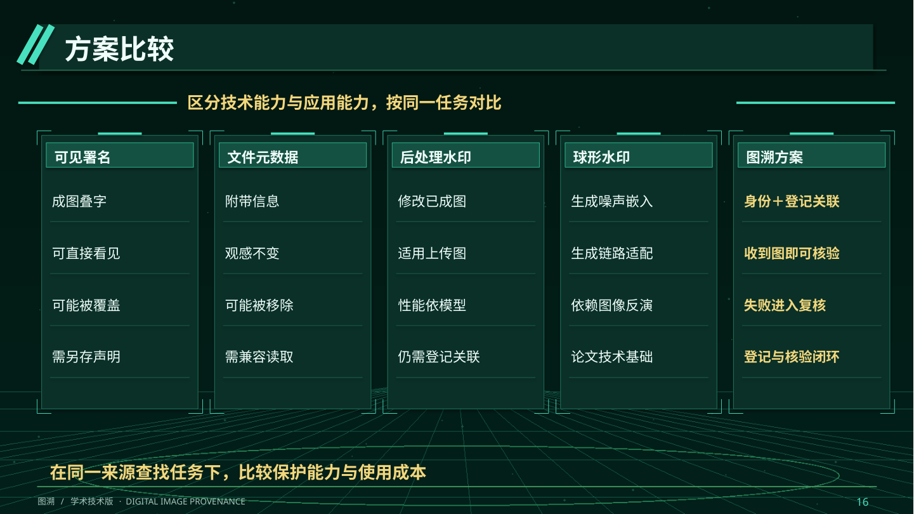

## 17 · 可靠性评估

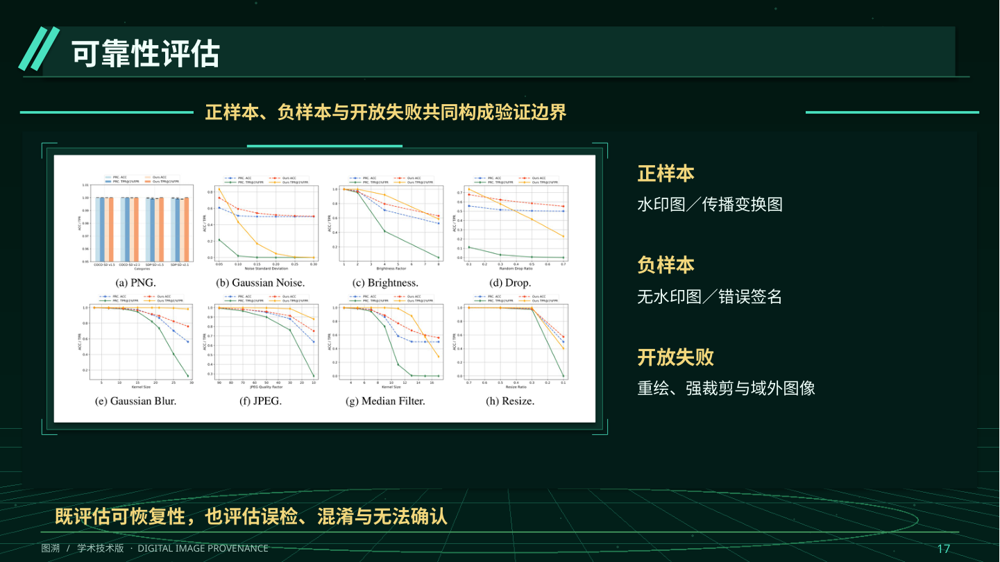

## 18 · 社会价值

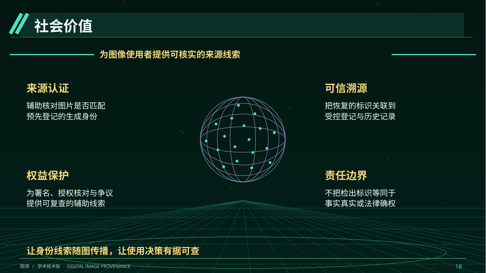

## 19 · 让每一次传播，都保留可核验的身份线索

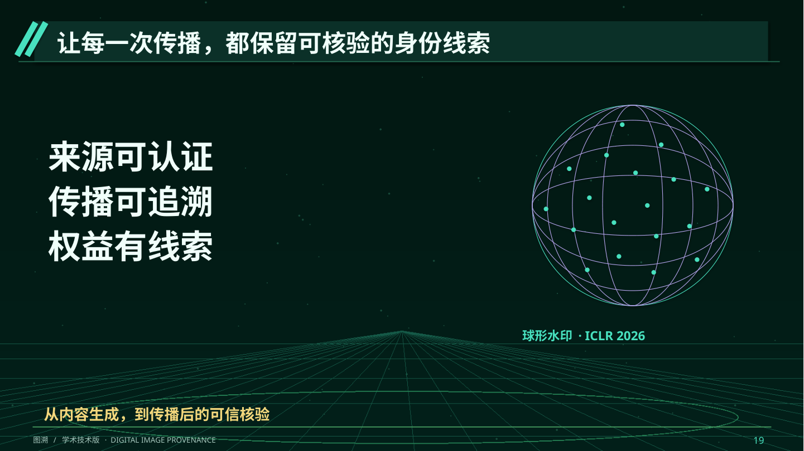
