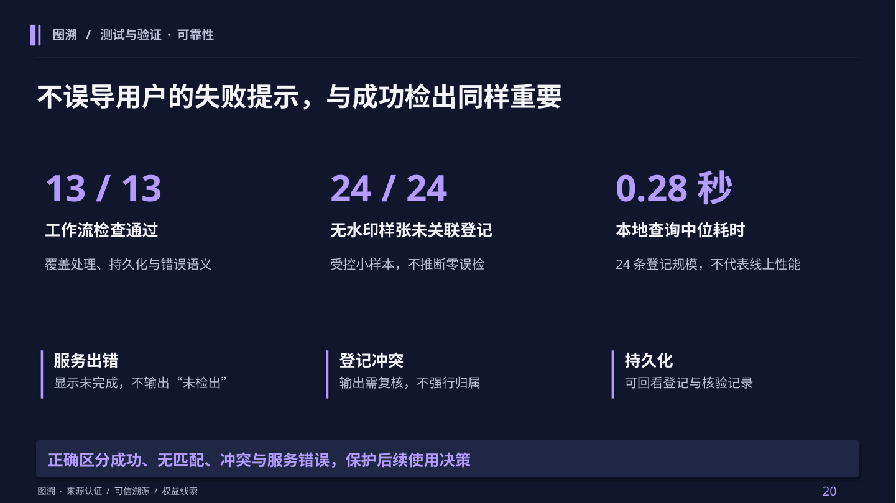
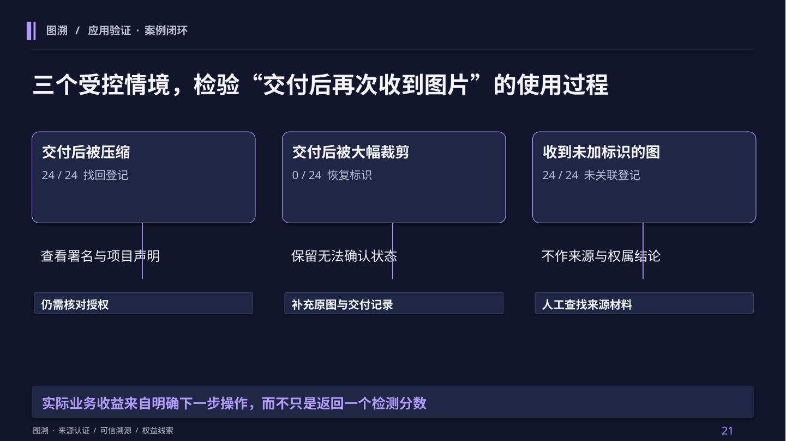
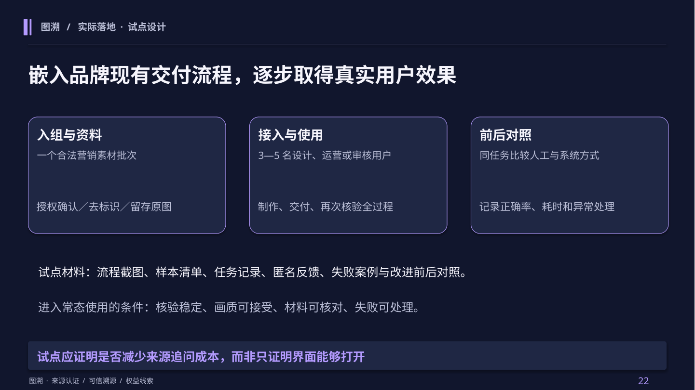
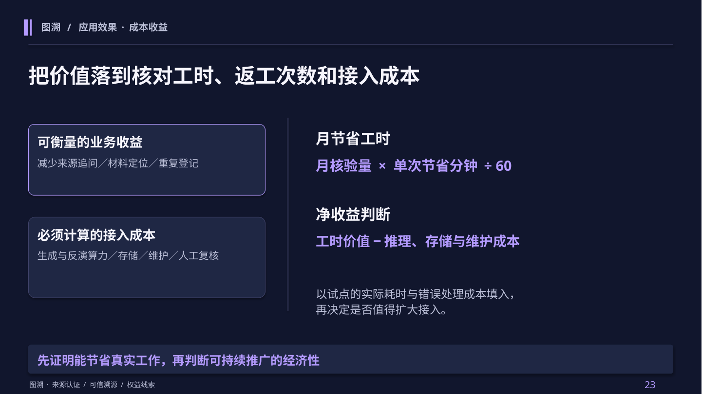
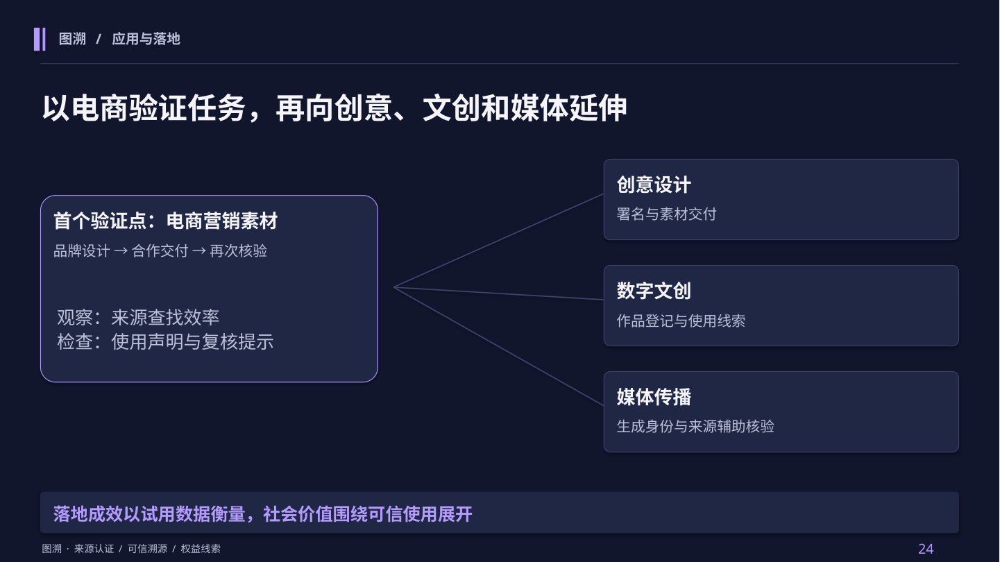
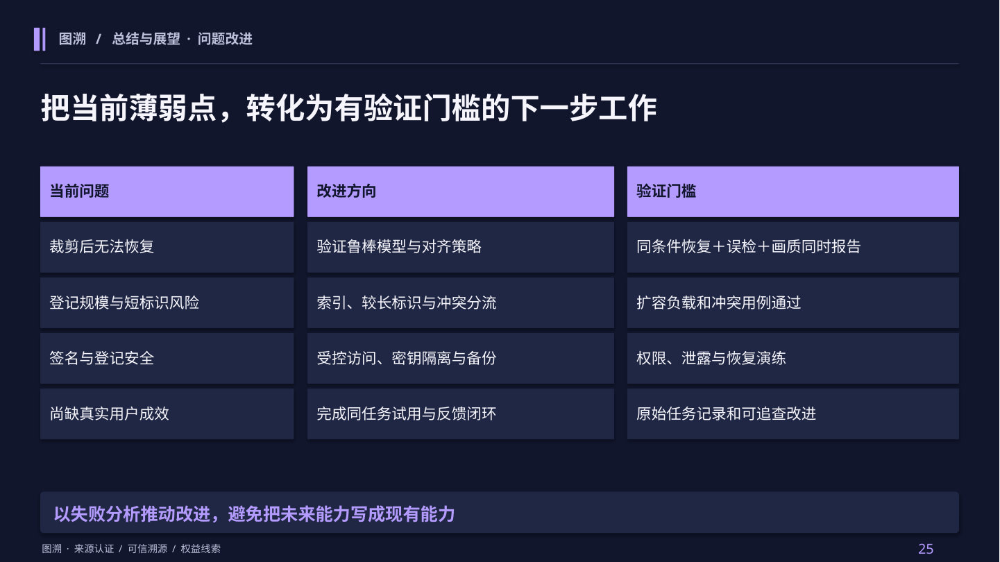
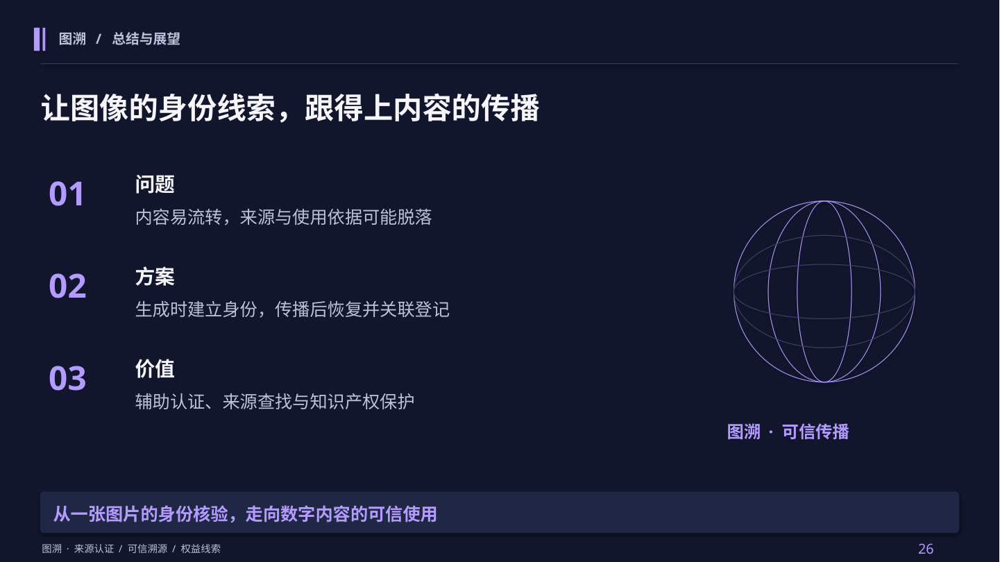
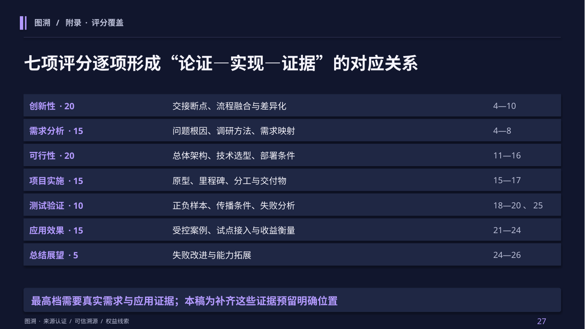

# 图溯 · 午夜蓝＋电光紫 · 评分与落地强化版

**26页正文＋1页评分附录。** 七项评分逐项覆盖，新增业务接入、部署资源、实施分工、受控测试、试点与成本收益。

[返回总览](../README.md) · [下载PPT](Tusu.pptx) · [浏览PDF](Tusu.pdf) · [测试与试点材料](../evidence/README.md)

## 01 · 项目概述

图溯

## 02 · 大背景

图像不仅传递信息，也承载创意、品牌与资产价值

## 03 · 核心矛盾

画面可以完整保留，来源说明却可能在传播中脱落

## 04 · 验证场景

用一张电商营销图，贯穿生成、交付与再次核验

## 05 · 需求分析 · 问题剖析

真正的断点，发生在“制作—交付—再次使用”的责任交接处

## 06 · 需求分析 · 调研方法

访谈问清真实经历，任务观察检验实际操作成本

## 07 · 需求分析

把用户的疑问，转化为可实现、可验收的系统要求

## 08 · 现有方案

单一保护方式，难以覆盖传播后的完整核验任务

## 09 · 创新与壁垒

把研究方法转化为可使用、可复查的可信传播流程

## 10 · 业务落地 · 操作闭环

一次交付建立身份，一次上传启动来源核验

## 11 · 总体方案

生成侧建立身份，接收侧恢复身份，登记层连接两端

## 12 · 技术选型

球形水印，适配“生成时标记、传播后核验”的需求

## 13 · 生成端技术

把作品身份映射为噪声，再参与扩散生成

## 14 · 核验端技术

恢复标识之后，还要完成来源关联与有效性检查

## 15 · 功能演示

保护与核验，落在用户看得见的两次操作上

## 16 · 可行性 · 部署与资源

网页、任务服务与模型环境分离，按实际负载逐步接入

## 17 · 项目实施 · 里程碑与协作

用阶段验收和明确交付物，连接算法、产品与验证工作

## 18 · 测试方案

用质量、恢复、误检与任务效率共同评价方案

## 19 · 测试与验证 · 受控试验

让结果同时呈现“可以恢复”与“暂时失效”的条件

## 20 · 测试与验证 · 可靠性

不误导用户的失败提示，与成功检出同样重要

## 21 · 应用验证 · 案例闭环

三个受控情境，检验“交付后再次收到图片”的使用过程

## 22 · 实际落地 · 试点设计

嵌入品牌现有交付流程，逐步取得真实用户效果

## 23 · 应用效果 · 成本收益

把价值落到核对工时、返工次数和接入成本

## 24 · 应用与落地

以电商验证任务，再向创意、文创和媒体延伸

## 25 · 总结与展望 · 问题改进

把当前薄弱点，转化为有验证门槛的下一步工作

## 26 · 总结与展望

让图像的身份线索，跟得上内容的传播

## 27 · 附录 · 评分覆盖

七项评分逐项形成“论证—实现—证据”的对应关系

