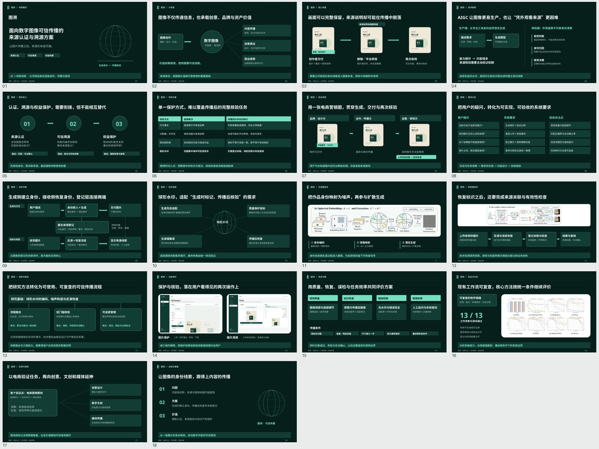
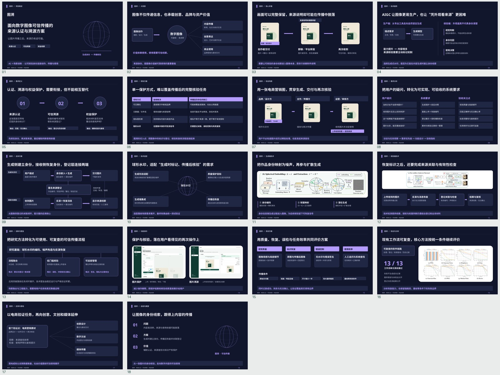

# 图溯 · 故事线重构版

**本次为18页新版，已替换此前19页版本。两版采用相同内容框架，仅视觉配色不同。**

内容顺序：数字图像价值 → 来源信息断裂 → AIGC放大问题 → 认证/溯源/权益需求 → 现有方案 → 电商验证情境 → 用户需求 → 图溯总体架构 → 技术选型 → 生成端与核验端 → 创新与难点 → 真实功能演示 → 测试验证 → 应用价值。

## A · 深墨绿

[逐页看图](A/README.md) · [下载可编辑PPT](https://raw.githubusercontent.com/Ssir-creator/AIC/main/ppt-reference-v2/A/Tusu.pptx) · [浏览PDF](https://raw.githubusercontent.com/Ssir-creator/AIC/main/ppt-reference-v2/A/Tusu.pdf)

## B · 午夜蓝＋电光紫

[逐页看图](B/README.md) · [下载可编辑PPT](https://raw.githubusercontent.com/Ssir-creator/AIC/main/ppt-reference-v2/B/Tusu.pptx) · [浏览PDF](https://raw.githubusercontent.com/Ssir-creator/AIC/main/ppt-reference-v2/B/Tusu.pdf)

## 本次关键修改

- 前8页围绕背景、痛点、场景和需求展开，未用论文图片填充。
- 第9页为图溯自行设计的应用总体架构。
- 论文原图集中在第11、12、16页，用于解释方法或实验分析。
- 第14页使用本次实际运行原型的功能截图；示例营销设计样张为自绘，不是AI生成场景图。
- 出处、截图所用实际方法及验证范围保存在演讲者备注。

文字、结构线与流程模块可编辑；论文图、截图和示例样张作为图片对象。
