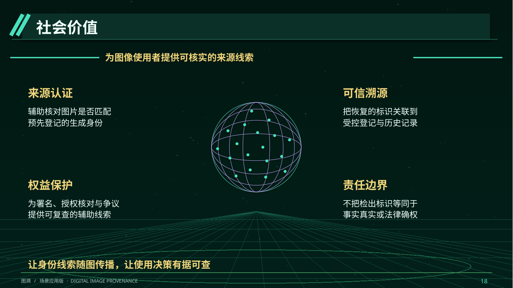

> 最新版已按三份参考分别制作三个独立PPT：[查看三份独立稿](../ppt-three-independent/README.md)。

# 图溯 · 三份参考稿重排版

两版均为34页，包含目录、4个章节过渡和评分附录，已替换旧版。

## A · 白底学术答辩版

借鉴水下机器人稿的白底蓝色页眉、对比图表、技术图与红色结论条。

**[逐页看图](A/README.md)** · [下载PPT](https://raw.githubusercontent.com/Ssir-creator/AIC/main/ppt-reference-v2/A/Tusu.pptx) · [浏览PDF](https://raw.githubusercontent.com/Ssir-creator/AIC/main/ppt-reference-v2/A/Tusu.pdf)

## B · 深蓝金色答辩版

采用第三份稿的深蓝金色层级，并结合铁轨守卫者的章节节奏、业务流程与实效案例组织。

**[逐页看图](B/README.md)** · [下载PPT](https://raw.githubusercontent.com/Ssir-creator/AIC/main/ppt-reference-v2/B/Tusu.pptx) · [浏览PDF](https://raw.githubusercontent.com/Ssir-creator/AIC/main/ppt-reference-v2/B/Tusu.pdf)

## 内容与评分覆盖

| 部分 | 页码 | 核心内容 |
|---|---|---|
| 研究背景与需求 | 4—10 | 大背景、来源断裂、具体业务、需求调研与现有方案 |
| 方案与技术设计 | 12—22 | 创新、业务流程、总体框架、论文方法、原型、部署与分工 |
| 测试验证与应用 | 24—30 | 条件设计、受控数据、失败案例、商户试点、经济性和拓展 |
| 总结与展望 | 32—33 | 改进门槛与能力边界 |
| 评分对应 | 34 | 七项评分到论证与证据的映射 |

[三份参考稿的具体借鉴说明](资料来源与版式借鉴.md) · [原始测试证据与调研/试点执行包](evidence/README.md)

配图仅采用相关论文原图、真实原型截图、自绘营销设计样张及实际测试样张，不使用与主题无关的AI场景图。标题、正文、流程与结构线可编辑；论文图与截图为图像对象。出处及验证范围置于演讲者备注。
