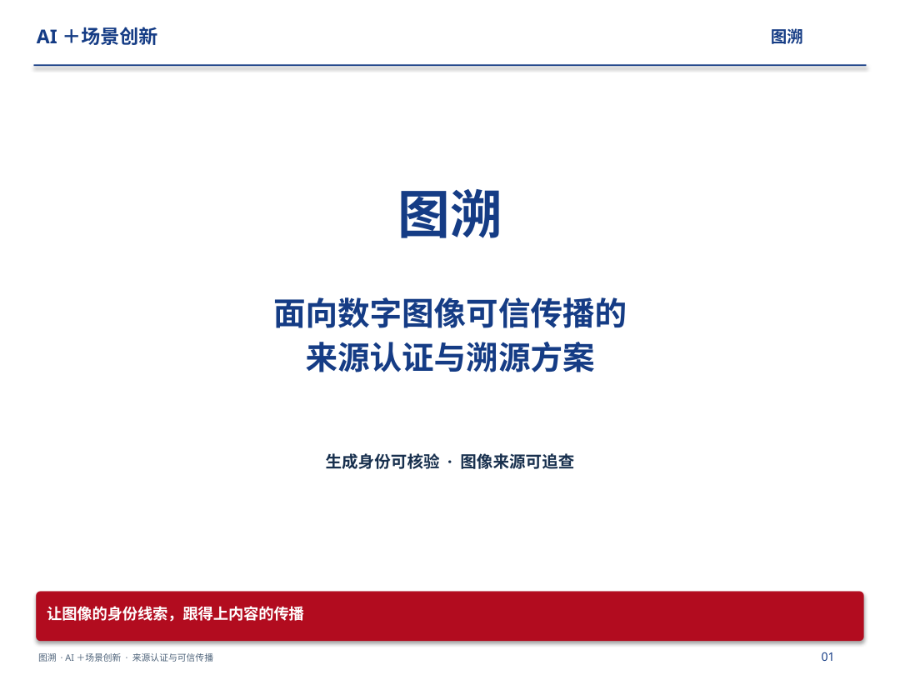
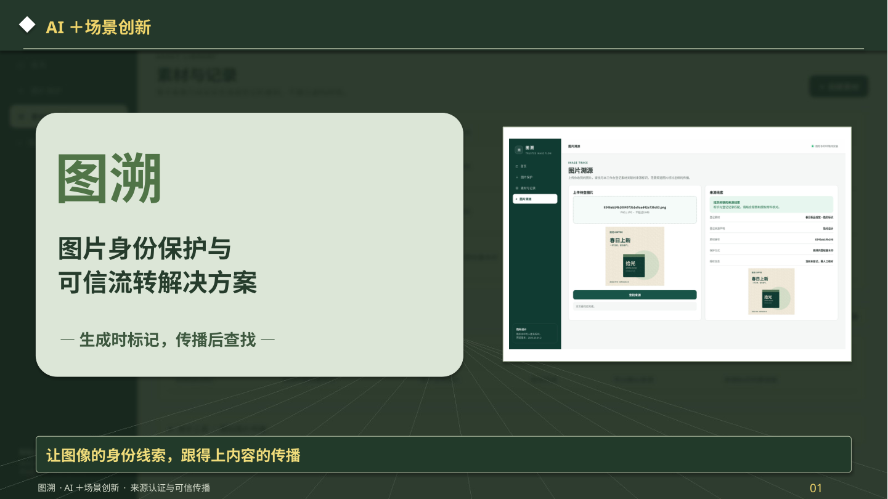
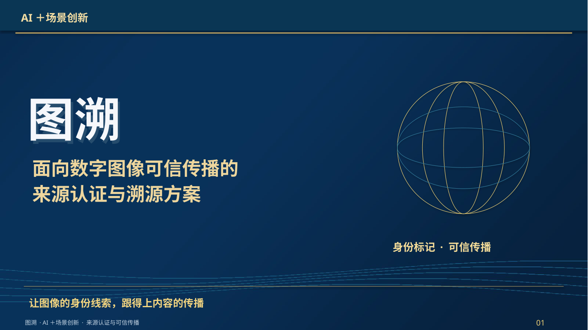

# 图溯 · 三份独立参考稿

**分别对应三份参考材料，三个独立PPT。** 每份单独安排版式、章节与图文结构，不是综合成两版。

| 独立版本 | 页数/画幅 | 在线看图 | PPT | PDF |
|---|---|---|---|---|
| 水下机器人参考版 | 29页 / 4∶3 | [逐页浏览](A/README.md) | [下载](https://raw.githubusercontent.com/Ssir-creator/AIC/main/ppt-three-independent/A/Tusu_Underwater.pptx) | [浏览](https://raw.githubusercontent.com/Ssir-creator/AIC/main/ppt-three-independent/A/Tusu_Underwater.pdf) |
| 铁轨守卫者参考版 | 35页 / 16∶9 | [逐页浏览](B/README.md) | [下载](https://raw.githubusercontent.com/Ssir-creator/AIC/main/ppt-three-independent/B/Tusu_Rail.pptx) | [浏览](https://raw.githubusercontent.com/Ssir-creator/AIC/main/ppt-three-independent/B/Tusu_Rail.pdf) |
| 单兵作战队参考版 | 39页 / 16∶9 | [逐页浏览](C/README.md) | [下载](https://raw.githubusercontent.com/Ssir-creator/AIC/main/ppt-three-independent/C/Tusu_System.pptx) | [浏览](https://raw.githubusercontent.com/Ssir-creator/AIC/main/ppt-three-independent/C/Tusu_System.pdf) |

## 水下机器人参考版

白底蓝色、五段学术目录、研究现状对比、红色结论条。

## 铁轨守卫者参考版

深绿灰色、六个菱形章节、作品介绍、技术应用与实效。

## 单兵作战队参考版

深蓝金色、五段系统设计目录、分系统模块与业务流程。

[三份参考的独立对应关系](参考对应说明.md) · [受控试验证据与调研/试点执行包](evidence/README.md)

三份稿均保留来源认证、可信溯源与权益线索的项目故事，并覆盖七项评分要求。落地内容包含业务流程、部署条件、角色分工、测试与失败案例、试点设计及成本收益。

素材仅采用相关论文原图、真实原型截图、程序自绘营销样张和实际受控试验样张。论文方法、原型方法与试点计划的具体范围见演讲者备注，未借用参考团队的奖项、专利或商业成绩。