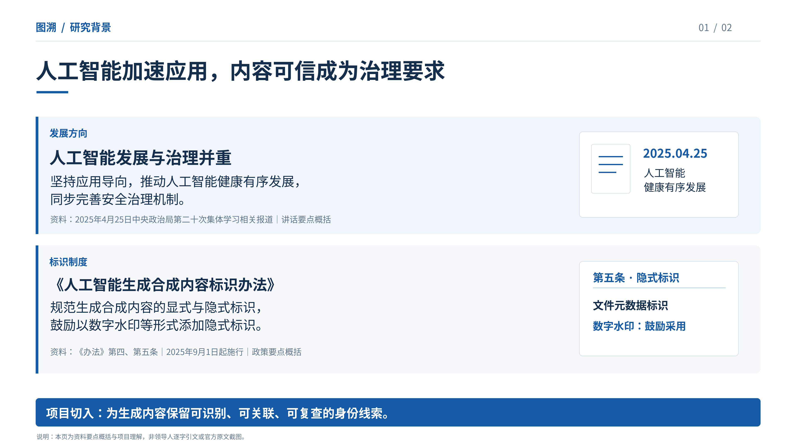
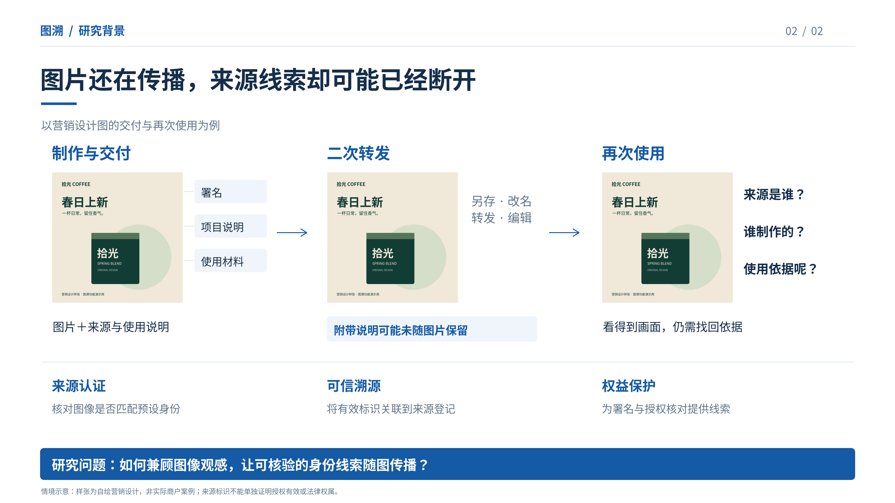

# 图溯：两页研究背景

**主线：国家治理要求 → 图片流转中的来源断点 → 兼顾观感与传播后核验的研究问题。**

两页背景之后再进入“客观挑战—现有方法不足—图溯回应”的三页，不在背景页展开球形水印公式。电商营销图仅是理解问题的一个例子，项目背景仍为数字图像可信传播。

## 第一页 · 政策方向

这一页解释为什么内容身份与可信使用值得关注，使用讲话和政策要点概括，非领导人逐字引文或官方原文截图。

[下载高清PNG](https://raw.githubusercontent.com/Ssir-creator/AIC/main/research-background/01_研究背景_政策方向.png)

## 第二页 · 现实问题

这一页以同一张图片的交付、转发、再次使用解释来源线索怎样分离，最后提出研究问题。

[下载高清PNG](https://raw.githubusercontent.com/Ssir-creator/AIC/main/research-background/02_研究背景_现实问题.png)

## 可复制内容

[查看文字稿与讲述稿](研究背景_文字稿.md)

图片均为3840×2160。情境样张为程序自绘设计，不是实际商户案例。政策与讲话原文此前访问受限，正式提交前需核对官方来源；本稿未将摘要写为逐字引语。
